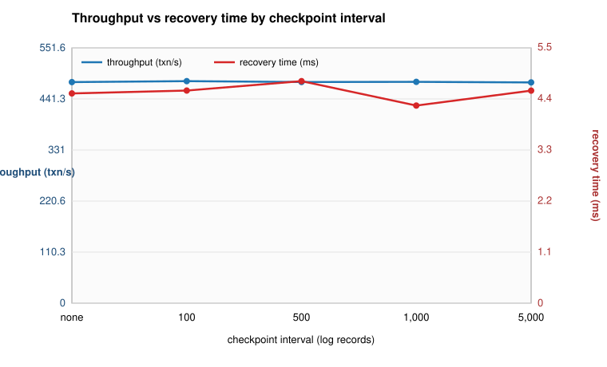
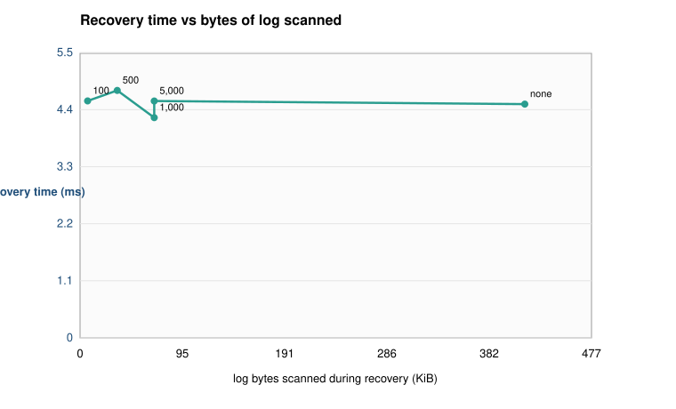

# SthirDB: A Disk-Resident Relational Engine with ARIES-Style Crash Recovery, Evaluated on a Constraint-Driven Retail Workload

> **Single-report policy.** This file is the only report in the project. Each phase drafts its own section here while the work happens; Phase 8 merges, de-duplicates, and formats. Raw numbers live in `docs/evidence/`. No other report files may exist in the repository.

*Draft state: skeleton created in Phase 0. Section ownership follows the table in `plan.md`.*

---

## 0. Title Block

**Title:** SthirDB: A Disk-Resident Relational Engine with ARIES-Style Crash Recovery, Evaluated on a Constraint-Driven Retail Workload

**Team:** Samyra — sole author (engine, experiments, report).

**Implementation:** C++17, POSIX file I/O, no third-party libraries; ~11,000 lines across `src/` plus 27 test programs.

**Demo date:** 5 November 2026.

**Abstract:** SthirDB is a relational database engine written from scratch: 8 KB slotted pages on disk, a frame-based buffer pool with LRU replacement and steal/no-force policies, a B+tree index, a Volcano-style executor, a cost-based optimizer, and ARIES write-ahead logging with three-pass restart recovery. Two novelties turn working code into evidence. First, a **constraint-aware optimizer** that uses primary-key, UNIQUE, CHECK and FOREIGN KEY metadata to delete work from the plan: a contradictory CHECK predicate reads 0 pages instead of 25, join elimination cuts a 100,000-row join from 125 ms to 15 ms, and foreign-key metadata drops a join estimate from 10,000,000 to 100,000 rows — while enforcement costs 68% on the write path. Second, a **crash-injection harness** that kills the engine at seven ARIES hazard points; all 1,050 randomized trials recover correctly, and two deliberately broken builds are caught. Constraints intercept 100% of injected anomalies at 1%, 5% and 10% contamination.

**Keywords:** ARIES, write-ahead logging, crash recovery, query optimizer, semantic query optimization, integrity constraints, B+tree index, buffer pool.

### 0.1 Team acknowledgement

| Field | Value |
|---|---|
| Name | Samyra ([Samyra312007](https://github.com/Samyra312007)) — storage, executor, optimizer, recovery, crash harness, evaluation, report |
| Name | Deepak — Phase 8 consolidation, demonstration suite, README and report formatting |
| Roll number | As recorded on the course submission form |
| Selected option | Full engine track: Phases 1–8 including both novelties (crash-injection testing and the constraint-aware optimizer) |
| Implementation language | C++17 |
| Demo date | 5 November 2026 |
| Reproducing everything | `make && make test`, then the nine `scripts/demo_*.sh` and the three experiment scripts (`benchmark.sh`, `constraint_aware_experiment.sh`, `crash_injection.sh`, `checkpoint_experiment.sh`) |

---

## 1. Introduction

**The problem.** A database is judged by what it does when things go wrong. Textbooks describe write-ahead logging and three-pass recovery precisely enough to implement, but the gap between "the algorithm is described correctly" and "the engine survives a real crash" is where most student projects stop: they run one scripted kill, watch the row reappear, and call it recovery. That demonstration cannot distinguish a correct implementation from one that happens to work on the five scenarios its author thought about. SthirDB was built to close that gap: every subsystem is exercised by an automated check whose failure is visible, and the two novelties are chosen so that the *evidence* is the contribution rather than the feature list.

**What was built.** Eleven thousand lines of C++17 implement a disk-oriented engine end to end. Pages are fixed 8 KB slotted frames with a per-page log sequence number (LSN); a buffer pool pins frames, evicts with LRU and writes pages only after their log records are durable; a B+tree maps key values to row identifiers; a Volcano executor runs scans, filters, joins, aggregates and sorts one tuple at a time; a parser and catalog support a SQL subset with primary keys, unique constraints, checks, foreign keys and `ON DELETE RESTRICT/CASCADE`; transactions take strict two-phase row locks; and ARIES write-ahead logging with fuzzy checkpoints makes the whole thing recoverable.

**Why ARIES.** Recovery is the part of a database that cannot be tested by inspection. ARIES was chosen because it is the reference algorithm — steal/no-force buffer management, repeating history during redo, compensation log records that make recovery itself recoverable — and because it makes a specific, falsifiable claim: after any crash, the recovered state equals the state produced by exactly the committed transactions. That claim can be checked mechanically, 1,050 times, from seeds. Simpler schemes (shadow paging, force-at-commit) would have made the harness easier and the project less interesting.

**The two novelties.** Novelty 1 (§6) is a constraint-aware optimizer: the planner reads the constraints the schema already declares and uses them as *facts about the data* — a primary key means at most one row matches, a CHECK that contradicts the predicate means zero rows, a foreign key means a join cannot multiply rows — then deletes scans, joins and estimates accordingly. Novelty 2 (§8) is the crash-injection harness: randomized kills at seven hazard points, five invariants checked from an external oracle, double recovery for idempotency, and mutation testing to prove the checker can fail.

**Scope and what is deliberately out.** The engine is single-process and single-node. Join ordering is limited to the two-table enumeration the cost model can price honestly; a general Selinger-style search is listed as future work (§11). The SQL subset covers what the retail workload needs, not the standard. These are scheduling decisions, not accidents, and §11 states each one with the measurement that would be needed to justify doing more.

> **Plain-English summary**
> - A database engine was built from scratch in C++17: pages on disk, a cache of those pages in memory, an index, a query executor, a planner, locks, and a write-ahead log.
> - It uses ARIES, the standard crash-recovery algorithm, because ARIES makes a claim that can be checked automatically: after any crash the data equals exactly what the committed transactions did.
> - The interesting part is not that the features exist but that each one is *measured*: two of the chapters (6 and 8) are about turning features into evidence.
> - Deliberate omissions (single node, two-table join search, a small SQL subset) are listed openly in §11 rather than hidden.

---

## 2. Background

This section defines every term the rest of the report uses, in plain English, at the point it first matters. A reader who knows databases can skip it; a reader who does not should be able to follow §3 onward after one pass.

**ACID.** Four promises a transaction makes. *Atomicity*: a transaction's statements all take effect or none do. *Consistency*: a transaction moves the database from one legal state to another (constraints hold before and after, not necessarily in the middle). *Isolation*: concurrent transactions cannot see each other's uncommitted work. *Durability*: once the database says "committed", the effect survives a power cut.

**Transaction.** A group of statements that succeeds or fails as a unit, delimited here by `BEGIN` and `COMMIT` (or `ABORT`).

**Page.** The unit of transfer between disk and memory — 8 KB here. A *slotted page* stores a small header, a directory of slots, and variable-length tuples packed from the end of the page backwards, so rows of different sizes share one page and deleted rows leave reusable holes.

**Buffer pool.** A fixed array of in-memory page frames plus a mapping from page id to frame. Reading a page *pins* its frame so it cannot be evicted while in use; releasing it *unpins*. When all frames are pinned or in use, a replacement policy (LRU here) chooses a *victim*.

**Steal and no-force.** Two buffer-management policies that decide how much work recovery must do. *Steal*: an uncommitted page may be written to disk (its frame may be stolen). *No-force*: a committed page need not be written at commit time. Together they mean the disk can hold a mixture of old, new, committed and uncommitted data — which is exactly why a log is needed.

**Write-ahead logging (WAL).** Append-only record of every change, written *before* the page it describes reaches disk. Each record carries a *log sequence number* (LSN), a monotonically increasing byte offset in the log. Each page carries the LSN of the last change applied to it, its `page_lsn`, which is what lets recovery decide "this page already has that change" and skip it.

**ARIES.** The recovery algorithm (Mohan et al., 1992) used here. On restart it runs three passes: *Analysis* scans the log forward from the last checkpoint to learn which transactions were in flight and which pages were dirty; *Redo* repeats history, reapplying every logged change whose LSN is newer than the page's `page_lsn`; *Undo* rolls back transactions that never committed, walking their log chains backwards and writing *compensation log records* (CLRs) so that a crash during recovery does not undo the same change twice. *Fuzzy checkpoint*: a checkpoint that records the transaction table and dirty-page table in the log without stopping the world or flushing pages.

**Index.** A separate structure mapping key values to row locations so a lookup does not have to read every page. SthirDB uses a B+tree: internal nodes hold keys and child pointers, leaf nodes hold keys and row ids and are linked for range scans.

**Query plan and cost model.** A *plan* is a tree of physical operators (scan, filter, join, aggregate, sort) that produces the answer. A *cost model* estimates how expensive each candidate plan will be — here, weighted page reads plus CPU per tuple — and the optimizer keeps the cheapest. *Cardinality estimation* is the sub-problem of guessing how many rows each operator emits; getting this wrong is the classic cause of bad plans.

**Semantic query optimization.** Using knowledge about the *meaning* of the data — constraints, keys, dependencies — to rewrite a query into an equivalent cheaper one, rather than only reordering the same operations. SthirDB's Novelty 1 (§6) is a small, rule-based instance of this idea.

**Constraint.** A rule the schema declares and the engine enforces: `PRIMARY KEY` (unique, not null), `UNIQUE`, `NOT NULL`, `CHECK (predicate)`, and `FOREIGN KEY ... REFERENCES ...` (a child value must match a parent key), with `ON DELETE RESTRICT` (refuse the parent delete) or `CASCADE` (delete children too).

**Seed and deterministic workload.** A number that makes a pseudo-random generator produce the same sequence every run. Every experiment here is seeded, so a reported result can be replayed; this is what makes §8's failures reproducible by typing one number.

> **Plain-English summary**
> - The report uses standard database vocabulary; this section defines each term in one sentence so the rest can be read without a textbook at hand.
> - The two policies that make recovery hard are *steal* (uncommitted data can reach disk) and *no-force* (committed data can stay in memory); the write-ahead log is what makes them safe.
> - ARIES recovers in three passes — analysis, redo, undo — and its compensation log records make recovery itself restartable.
> - A cost model guesses how expensive a plan is; a *semantic* optimizer is one that uses declared facts about the data (keys, checks, foreign keys) instead of only reordering operations.

---

## 3. System Overview

_Drafted in Phase 2._

This section describes the end-to-end software architecture of SthirDB and follows the complete lifecycle of a SQL query from user input to disk retrieval. SthirDB processes declarative SQL text through a classical layered DBMS architecture: tokenization, AST generation, semantic validation against a persistent catalog, translation into relational algebra, and demand-driven iterator execution over a pinned buffer pool.

### 3.1 Architecture Diagram

Figure 1 outlines the layered subsystem hierarchy delivered across Phases 0–2.

```
       +-----------------------------------------------------------+
       |               Client CLI (sthirdb run "<sql>")            |
       +-----------------------------------------------------------+
                                     |
                                     v
       +-----------------------------------------------------------+
       | SQL Lexer & Parser (Hand-written recursive descent)       |
       |  - Tokenizer with source-location error reporting         |
       |  - AST: DDL (CreateTable), DML (Insert/Update/Delete),    |
       |        DQL (Select/Join/Agg/Sort), Control (Txn, Set)     |
       +-----------------------------------------------------------+
                                     |
                                     v
       +-----------------------------------------------------------+
       | Catalog (./data/retail/catalog.json)                      |
       |  - Table schemas, data types (INT, VARCHAR, DECIMAL)      |
       |  - Declared constraints (PK, UNIQUE, CHECK, FK, NOT NULL) |
       +-----------------------------------------------------------+
                                     |
                                     v
       +-----------------------------------------------------------+
       | Relational-Algebra Planner                                |
       |  - Semantic resolution & schema derivation                |
       |  - Plan nodes: SeqScan, Filter, Project, Aggregate,       |
       |    Sort, NestedLoopJoin                                   |
       +-----------------------------------------------------------+
                                     |
                                     v
       +-----------------------------------------------------------+
       | Volcano Execution Engine (Iterator: init / next / close)  |
       |  - Three-valued logic (3VL: TRUE, FALSE, UNKNOWN)         |
       |  - Hash aggregation (COUNT, SUM, AVG, MIN, MAX)           |
       |  - In-memory multi-key sort (ASC / DESC)                  |
       |  - Block nested-loop join with inner rescan               |
       |  - DML execution with slot tombstones                     |
       +-----------------------------------------------------------+
                                     |
                                     v
       +-----------------------------------------------------------+
       | Buffer Pool Manager (64 frames, LRU eviction replacer)    |
       |  - Frame array, page-to-frame table, pin/unpin protocol   |
       +-----------------------------------------------------------+
                                     |
                                     v
       +-----------------------------------------------------------+
       | Disk Manager (8 KB slotted pages in ./data/retail/*.dat)  |
       |  - Positional pread/pwrite with crash-injection hook      |
       +-----------------------------------------------------------+
```
**Figure 1.** SthirDB end-to-end query processing and storage architecture.

### 3.2 Journey of a Query

To understand how these components collaborate, consider the lifecycle of an acceptance query executed via `./build/sthirdb run`:

```sql
SELECT ItemName FROM Items WHERE RetailPrice > 5;
```

1. **Tokenization & Lexical Analysis:** The `Lexer` scans the input character stream and converts it into a sequence of strongly-typed tokens: `SELECT`, `IDENTIFIER("ItemName")`, `FROM`, `IDENTIFIER("Items")`, `WHERE`, `IDENTIFIER("RetailPrice")`, `GT(">")`, `INTEGER_LITERAL("5")`, `SEMICOLON`.
2. **Parsing & AST Construction:** The hand-written recursive-descent `Parser` processes tokens according to grammar rules, enforcing operator precedence. It outputs a `SelectStmt` AST node containing a projection list (`ItemName`), a table source (`Items`), and a binary comparison expression (`RetailPrice > 5`).
3. **Catalog Lookup & Semantic Analysis:** The `Planner` looks up `Items` in the persistent `Catalog` (`./data/retail/catalog.json`). It confirms the table exists, verifies that both `ItemName` and `RetailPrice` are valid columns, and determines their storage types (`VARCHAR(100)` and `DECIMAL`).
4. **Relational-Algebra Planning:** The planner produces an executable plan tree composed of:
   - `SeqScanPlan("Items")`: leaf node reading records from disk.
   - `FilterPlan(predicate: RetailPrice > 5, child: SeqScan)`: filters records.
   - `ProjectPlan(columns: [ItemName], child: Filter)`: extracts the requested output column.
5. **Physical Execution (Volcano Iterator Model):** The `ExecutionEngine` instantiates the corresponding executor tree (`ProjectExecutor` -> `FilterExecutor` -> `SeqScanExecutor`) and calls `init()` on the root.
6. **Buffer-Pool Access & Slotted-Page Deserialization:** When `FilterExecutor` calls `next()` on `SeqScanExecutor`:
   - `SeqScanExecutor` pins page 0 via `BufferPool::fetch_page(0)`.
   - For each active slot in the slotted page directory, it extracts the tuple bytes and deserializes the dynamic `Tuple` format, recording the record identifier (`RID{page_id, slot_id}`).
   - Once all slots on the page are read, `unpin_page(0, false)` decrements the pin count, and the executor advances to page 1.
7. **Predicate Evaluation with 3VL:** `FilterExecutor` evaluates `RetailPrice > 5` against each live tuple using three-valued logic. Comparisons involving `NULL` yield `UNKNOWN`, which the `WHERE` clause discards; only rows evaluating to `TRUE` pass to `ProjectExecutor`.
8. **Result Formatting:** `ProjectExecutor` yields a tuple containing only `ItemName = 'Widget'`. The CLI engine calculates column widths and prints a clean ASCII table (raw output verified in `docs/evidence/phase2_cli_verify.txt`):
   ```
   +----------+
   | ItemName |
   +----------+
   | Widget   |
   +----------+
   (1 row(s))
   ```

### 3.3 Definitions of Technical Terms

- **AST (Abstract Syntax Tree):** A tree representation of the syntactic structure of source SQL text, abstracting away punctuation and formatting.
- **Relational Algebra:** A formal mathematical query language consisting of relational operators (such as selection, projection, join, and aggregation) that define query semantics.
- **Volcano Iterator Model:** A pipelined query execution architecture where operators communicate through a uniform `init()`, `next()`, and `close()` interface, pulling tuples one at a time on demand.
- **Three-Valued Logic (3VL):** SQL's logical system with three truth states: `TRUE`, `FALSE`, and `UNKNOWN`. Comparisons with `NULL` evaluate to `UNKNOWN`, and `WHERE` filters preserve only rows evaluating to `TRUE`.
- **Slotted Page:** An 8 KB page storage layout that places a growing slot directory at the front and appends variable-length tuples backward from the end, enabling stable row identifiers via slot indices.
- **Constraint Declaration vs. Enforcement:** Storing declared data rules (such as `PRIMARY KEY`, `UNIQUE`, `CHECK`, and `FOREIGN KEY`) in the catalog during DDL parsing, while deferring runtime constraint violation checks to the transaction enforcement phase.

> **Plain-English summary**
> - SQL text is parsed into an AST without external dependencies and validated against a JSON table catalog.
> - Queries are converted into relational algebra trees and executed using the demand-driven Volcano iterator model.
> - SeqScan retrieves pages through the pinned 64-frame buffer pool and deserializes slotted-page records.
> - Filtering strictly implements SQL three-valued logic (NULL comparisons yield UNKNOWN).
> - All six Phase 2 acceptance statements execute successfully from the CLI with clean tabular output (`docs/evidence/phase2_cli_verify.txt`).

---

## 4. Storage, Indexing & Query Execution

_Drafted in Phases 1–3. Subsections 4.1–4.4 cover the Phase 1 page format and buffer pool; 4.5–4.7 cover the Phase 3 B+tree index and its verification. The SQL execution layer is described in §3.2 and its acceptance evidence lives in `docs/evidence/phase2_*.txt`._

### 4.1 Page format

SthirDB stores every table in one file. Page *i* of that file lives at byte offset `i × 8192`. The page size is **8 KB (8192 bytes)** and is locked for the whole project.

Each page is a *slotted page*: a fixed header, then a slot directory that grows forward from the header, then free space, then tuples that grow backward from the end of the page. The slot directory lets a tuple be found (by slot number), deleted (tombstoned), and later compacted without moving every other tuple by hand.

Page header layout (16 bytes, stored at the front of the page image):

| Offset | Size | Field | Meaning |
|---|---|---|---|
| 0 | 4 B | `page_id` | Identifier of this page within its table file. |
| 4 | 8 B | `page_lsn` | Log sequence number of the last log record that modified this page. **Reserved in Phase 1; written from Phase 5** so redo can skip already-applied records (idempotent recovery). |
| 12 | 2 B | `slot_count` | Number of entries in the slot directory. |
| 14 | 2 B | `free_space_ptr` | Offset of the lowest-addressed tuple. Free space is the byte range `[16 + slot_count × 4, free_space_ptr)`. |

Each slot-directory entry is 4 bytes: `uint16 offset` (tuple position in the page) and `uint16 length` (tuple length; **0 means tombstoned** — the slot is free but the space is reclaimed only by compaction).

The Phase 1 demo table `Items` uses one fixed row layout of 63 bytes:

```
[int32 id][char[50] name][double price][bool deleted]
```

`serialize_row` / `deserialize_row` convert between this layout and the in-memory `Row` struct. The `deleted` flag supports logical delete (Phase 2 `DELETE`); slot tombstones support physical reuse.

### 4.2 Buffer pool

The buffer pool keeps a fixed number of in-memory *frames* (64 by default) that mirror 8 KB pages. Its jobs: reuse frames, respect pins, and write dirty pages back before reusing their frames.

- **Frame array** — `pool_size` pages of 8 KB each.
- **Page table** — hash map `page_id → frame_id`.
- **Pin counts** — a page may be evicted only when its pin count is 0. Callers `fetch_page` (pin +1) and `unpin_page(page_id, is_dirty)` (pin −1, optionally mark dirty).
- **Dirty flags** — set on unpin when the caller modified the page; on eviction of a dirty frame the pool writes the page back through the disk manager.
- **Free list** — frames never assigned; used before eviction is considered.
- **Replacer (LRU)** — tracks evictable frames (pin count 0) and returns the least-recently-used one on eviction. Contract: `record_access`, `set_evictable`, `evict`, `remove`, `size`.
- **Latch** — one mutex guards the whole pool, so `fetch_page` / `unpin_page` are thread-safe.

Pin protocol (the invariant every caller must follow): every successful `fetch_page` is matched by exactly one `unpin_page`; holding a pin across an operation keeps the page resident; marking dirty happens at unpin time, not at modify time.

### 4.3 Disk manager and crash-injection hook

The disk manager exposes `read_page`, `write_page`, and `allocate_page`. Every page write funnels through one low-level function, which calls `crash_point(name)`. In normal runs `crash_point` is a no-op; under the test flag (`STHIRDB_CRASH_POINT=<name>`) it hard-exits the process with no cleanup — the hook Novelty 2 (Phase 5B) will use to inject crashes without touching call sites.

### 4.4 Stress verification (Phase 1)

A stress test writes 5,000 rows through the buffer pool and reads every page back, verifying `id`, `name`, `price`, and the delete flag on every tuple. Two pool sizes were run: the specified 64-frame pool (41 pages of data, so the pool is large enough to hold the whole table), and an 8-frame pool that forces continuous eviction — every pass over the data writes dirty victims back and reloads them (Table 1).

**Table 1.** Phase 1 stress results (raw log: `docs/evidence/phase1_tests.txt`).

| Test | Frames | Rows | Pages | Write (ms) | Read+verify (ms) | Verified | Mismatches | Outcome |
|---|---|---|---|---|---|---|---|---|
| Stress A (spec pool) | 64 | 5000 | 41 | 0.81 | 0.23 | 5000 | 0 | PASS |
| Stress B (forced eviction) | 8 | 5000 | 41 | 0.65 | 0.25 | 5000 | 0 | PASS |

The end-to-end CLI check (`init_schema`, `load_data --rows 5000`, `count`) exits 0 and `count` returns exactly 5000 (`docs/evidence/phase1_cli_verify.txt`). All 21 unit tests pass (`docs/evidence/phase1_tests.txt`). One honest note: with 5,000 rows the table occupies only 41 pages, so the 64-frame run never evicts — the 8-frame run exists specifically to exercise eviction cycles and dirty writeback.

> **Plain-English summary**
> - A page is an 8 KB block with a 16-byte header, a slot directory up front, and tuples packed at the back.
> - `page_lsn` is in the header now but only starts being written in Phase 5, when ARIES lands.
> - The buffer pool holds 64 pinned-or-not frames, evicts only unpinned frames (LRU), and writes dirty pages back first.
> - Every disk write goes through one function with a crash hook, so crash tests later need no call-site changes.
> - The 5,000-row stress test passed with both a 64-frame and an 8-frame pool.

### 4.5 B+tree node format

The index is a disk-resident B+tree stored in its own file (`items.idx_price.idx` lives beside `items.dat`), so index pages are paged through their own buffer pool and never displace table pages. Every node is one 8 KB page with a 16-byte header shared by both node kinds.

**Figure 1.** Node layout inside one 8 KB index page.

```
leaf page
+----------+-------------------+----------------------+---------------------------+
| header   | next_leaf_page_id | keys[0..n)  int64    | rids[0..n)  6 B each      |
| 16 B     | 4 B               | 8 B each, sorted     | uint32 page_id + uint16 slot |
+----------+-------------------+----------------------+---------------------------+
  ^ page_id(4) page_lsn(8) is_leaf(1) reserved(1) key_count(2)

internal page
+----------+----------------------+----------------------------+
| header   | keys[0..n)  int64    | children[0..n]  uint32     |
| 16 B     | separator keys       | n+1 child page ids         |
+----------+----------------------+----------------------------+
```

- `page_lsn` is carried in every index page header for the same reason as in table pages: Phase 5 redo will skip already-applied page changes.
- Leaf `rid` entries are 6 bytes (`uint32 page_id`, `uint16 slot_id`) and point at a tuple slot in the table file, so an index lookup costs one index descent plus one table page fetch per matching RID.
- Leaves are chained in key order by `next_leaf_page_id`; that chain is what makes range scans possible without revisiting internal nodes.

**Simplifications (deliberate, for the course project).** The tree order is fixed at **order 4**, i.e. at most 3 keys per node (`kIndexMaxKeys = kIndexOrder - 1`), and keys are **int64**. Fixed order keeps split/promote logic small enough to reason about and to show on one slide; it also means a node is mostly empty space (see the honest note in §4.7). INT columns use the value as the key; DECIMAL columns are indexed as **cents** (`round(value × 100)`), because the key type is integer. VARCHAR keys are rejected: they would need a different key type.

**Figure 2.** Splitting a full leaf (order 4) when a fourth key arrives.

```
before:   [ 1 | 2 | 3 | 4 ]                    (4 keys = overflow)
after:    [ 1 | 2 ]      [ 3 | 4 ]
              \             ^
               \            |
             next_leaf ----+        parent gains separator 3 (copy-up:
                                    the key stays in the right leaf)

internal split (push-up):  [ 5 | 7 | 9 | 11 ]  ->  median 9 moves up,
                           left keeps [5,7], right keeps [11], children split 3 / 2
```

### 4.6 Index operations and pin discipline

- **Insert** descends to the leaf taking the first separator `>= key` (so equal keys stay left), inserts at the upper bound of the key's run, and splits on overflow: a leaf split copies its first key up, an internal split pushes its median up. Splits propagate to the root; when the root splits, a new root is allocated and the height grows by one.
- **Point lookup** descends the same way and returns every RID whose key matches. Because duplicates may straddle a leaf boundary, it keeps following `next_leaf_page_id` while the current leaf's last key is still `<= key`; entries are only collected while `key` matches, so a duplicate run that spans many leaves is returned in full.
- **Range scan** descends to the leaf where the range starts, then walks the leaf chain forward until a key exceeds the upper bound.
- **Pin discipline.** A descent holds **one** pin at a time: a node is fetched, decoded into memory, and unpinned before its child is fetched, and the path back to the root is remembered as page ids only. A split holds **two** pins — the node being split and its new right sibling — and releases both before propagating to the parent, so no more than two index pages are ever pinned at once. All index node I/O goes through the buffer pool; the tests assert that the pool has no pinned frames left when they finish.
- **CREATE INDEX** scans the table exactly like `SeqScan` (one table page pinned at a time), inserts `(key, RID)` into a fresh tree, flushes it, and records `root_page_id`, `height` and `order` in `catalog.json` (§4.5 node format, §3.1 catalog). NULL values are not indexed.
- **IndexScan** turns a WHERE clause into a key range, reads the matching RIDs from the tree, fetches each base tuple by RID, drops RIDs whose slot was tombstoned, and **rechecks the predicate**. Range bounds are widened by one key unit on purpose: the recheck makes a superset range safe, which absorbs decimal scaling and float rounding instead of silently dropping rows.

### 4.7 Phase 3 verification

The tree was exercised with the three required workloads. Table 2 reports what the tests measured (raw log: `docs/evidence/phase3_tests.txt`).

**Table 2.** B+tree verification (order 4, 8 KB pages, 64-frame index buffer pool).

| Workload | Inserted entries | Height | Leaves | Index pages | Insert time | Lookups / ranges verified | Outcome |
|---|---|---|---|---|---|---|---|
| 10,000 ascending keys | 10,000 | 9 | 5,000 | 7,501 | 51.6 ms | all 10,000 found; range `[9000,9100]` = 101 rows; full range in key order | PASS |
| 10,000 random keys (adversarial order) | 10,000 | 9 | 4,270 | 6,452 | 123.4 ms | all 10,000 found; full range returns all keys in sorted order; missing key empty | PASS |
| 5,000 duplicate entries (50 keys × 100 copies, interleaved) | 5,000 | 9 | 2,498 | 4,662 | 70.0 ms | each key returns exactly its 100 RIDs, once each; range returns 5,000 | PASS |

**Access-path equivalence.** A 605-row `Items` table (600 rows priced `0.25 × i`, plus 5 rows priced `60.00` so the index must handle duplicates) was queried on the SeqScan+Filter path, then `CREATE INDEX idx_price ON Items (RetailPrice)` was run and the same SQL re-executed. `EXPLAIN` flips from `Filter → SeqScan` to `IndexScan(...)`, and the result multisets are identical for `RetailPrice > 50` (405 rows), `RetailPrice = 60.00`, `RetailPrice >= 50 AND RetailPrice <= 60`, and `COUNT(*)` (405). The index metadata survives a restart (a fresh catalog + engine still plans an `IndexScan`), and the same equivalence holds on the 5,000-row CLI table: `COUNT(*) WHERE price > 1.5` returns 4949 rows on both paths and `price > 50.95` returns the same four rows (`docs/evidence/phase3_cli_verify.txt`).

**Honest notes / limitations.** (i) Order 4 is chosen for clarity, not capacity: a node holds 3 keys, so 10,000 keys need ~7,500 pages (~59 MB) — a production order (~500 keys per 8 KB page) would need roughly two orders of magnitude fewer pages. (ii) `CREATE INDEX` builds the index from a table snapshot; Phase 3 does **not** maintain indexes on `INSERT` / `UPDATE` / `DELETE`. Reads stay safe because the executor discards tombstoned RIDs and rechecks the predicate, but rows written after the build are not reachable through the index — rebuild the index after bulk changes. (iii) Phase 3 installs a simple rule ("use an existing index when the WHERE clause yields key bounds"); Phase 4 replaces it with the cost-based choice.

> **Plain-English summary**
> - An index page is an 8 KB block: leaves hold sorted keys plus table RIDs and a link to the next leaf; internal pages hold separator keys and child page ids.
> - Splitting a full leaf copies its first key up to the parent; splitting an internal node pushes its middle key up; splitting the root adds a level.
> - Lookups can return every copy of a duplicated key even when the copies sit in several different leaves.
> - Only one index page is pinned while descending, two while splitting — so a split cannot pin the whole path.
> - 10,000 ascending, 10,000 random and 5,000 duplicate keys all verified, and the index returns exactly the same rows as a sequential scan plus filter.

---

## 5. Optimizer

Phase 4 replaces Phase 3's static rule ("use an existing index when the WHERE clause yields key bounds") with a real, if small, optimizer. For a single-table SELECT it enumerates exactly two access paths — `SeqScan → Filter` and, when an index exists on a column referenced by an equality/range predicate, `IndexScan → Filter` — estimates the cardinality of each candidate from persisted table statistics, prices it with a page-based cost model, and picks the cheaper path. The choice is explainable: `EXPLAIN "<sql>"` prints the chosen plan as an indented tree with predicted rows and cost per node plus every rejected alternative with its cost, `optimizer "<sql>"` executes the query and adds `estimated_cost`, `actual_time_ms`, `rows_estimated` vs `rows_actual` and an `estimation_error` ratio, and `ANALYZE <table>` refreshes and persists the statistics. Raw transcripts: `docs/evidence/phase4_cli_verify.txt` and `docs/evidence/phase4_tests.txt`.

**LEON is context, not implementation.** LEON (Chen et al., PVLDB 2023, DOI 10.14778/3598581.3598597) is cited here only to frame where optimizer research is heading — learning-based, ML-aided plan and cardinality choice. **Nothing in this phase learns anything**: no model is trained, no parameter is fitted from data. The estimator is the classical NDV + histogram machinery below, and every number in this section comes from it. We say this explicitly so no evaluator goes looking for a learned component that was never promised.

### 5.1 Statistics and cardinality estimation

`ANALYZE <table>` scans the table exactly like `SeqScan` (one page pinned at a time) and computes, for every INT/DECIMAL column: `row_count`, `ndv` (number of distinct values), `min`, `max`, and a **3-bucket equi-width histogram** over `[min, max]`. `CREATE INDEX` does the same for its own column at build time, so a freshly built index is immediately costable. Statistics are persisted in `catalog.json` next to the index metadata. VARCHAR columns are not analyzed (the Phase 3 index keys INT/DECIMAL too).

What the 5,000-row demo table actually stores after `ANALYZE Items`:

```
column price: row_count=5000  ndv=5000  min=1.00  max=50.99
  bucket [ 1.00, 17.66): 1667 rows
  bucket [17.66, 34.33): 1666 rows
  bucket [34.33, 50.99]: 1667 rows
column id:    row_count=5000  ndv=5000  min=1  max=5000  (same 3-bucket shape)
```

**Cardinality rules** (selectivity × `row_count`, clamped to `[0, row_count]`):

- **Equality** → `row_count / NDV`. For `price = 25.55`: 5000 / 5000 = **1 row**.
- **Range** → fractional histogram overlap: each bucket contributes `count × (overlap width / bucket width)`, i.e. rows are assumed **uniform within a bucket**. For `price > 1.5`: bucket 1 contributes 16.16/16.66 × 1667, buckets 2–3 contribute fully → 4950 rows.
- **Conjunction (AND)** → `s1 × s2` — the **independence assumption**. This is an assumption, not a claim about the data; §5.4 shows exactly what it costs when it is violated.
- **Disjunction (OR)** → `s1 + s2 − s1×s2` (inclusion–exclusion, which needs no independence).
- **Unanalyzed column** (never `ANALYZE`d, or VARCHAR): conventional defaults — 0.1 for equality, 1/3 for a range. These are defaults, not measurements.

**Histogram choice: 3-bucket equi-width, locked for the project.** Three buckets are few. The weakness is concrete: a predicate narrower than one bucket can only be localized to that bucket and then spread uniformly across it, and two range predicates on the *same* column are still multiplied under AND as if they were independent. Both failure modes are measured in §5.4 rather than hand-waved.

### 5.2 Cost model

```
cost(plan) = pages_read × seq_page_cost  +  pages_random × rand_page_cost
             seq_page_cost = 1.0          rand_page_cost = 4.0
```

These two constants are **chosen, not measured**: we assume a random page fetch costs four sequential reads, a conventional ratio for spinning disks that is generous to sequential scan on any storage. Operator costs:

- `seq_scan_cost` = `pages(table)` — every page read once, sequentially.
- `index_scan_cost` = `index_height + pages_of_matching_rows` — the tree descent reads `index_height` pages (sequential-priced; the path is short and buffer-resident), then the matching table pages are fetched by RID and priced as random reads, where `pages_of_matching_rows = ceil(matching_rows × pages(table) / row_count)`, clamped to `[1, pages(table)]`: matching rows are assumed to occupy their proportional share of the table's pages. For the demo table (`pages = 41`, `height = 8`): an equality lookup matches 1 row → `8 + 1×4 = 12`; `price > 1.5` matches 4,950 rows → all 41 pages → `8 + 41×4 = 172`.
- `filter_cost` = child cost — predicate evaluation is CPU; the model counts page I/O only.
- `sort_cost` = 0 while the data fits the 64-frame pool (512 KB), otherwise `2 × spill pages` (one write pass + one read pass).
- `aggregate_cost` = child cost — hash aggregation is in-memory at this scale.
- `nested_loop_join_cost` = `pages(outer) + rows(outer) × pages(inner)` — the inner side is rescanned once per outer row.

An earlier draft charged **one random fetch per matching row** (`min(rows, pages)`). That formula contradicts the spec's `pages_of_matching_rows` and measured badly: it priced any predicate matching more than ~8 rows as a full-index sweep, so the optimizer chose a 2.6 ms SeqScan over a 1.4 ms index path on mid-selectivity queries. The density-based estimate fixed it (`fix(optimizer): price index scans by pages of matching rows`); §5.4's sweep is the before/after check.

**Join-order enumeration (documented stretch item).** `EnumerateJoinOrders()` enumerates all `3! = 6` left-deep orders of a three-table join, costs each with the nested-loop formula above, and returns them cheapest-first; `test_join_order_enumeration` asserts all six orders appear exactly once, that costs are sorted, and that the cheapest plan starts from the smallest outer table (`Customers`: `10 + 800×41 + 800×5000×60`). Join-order search is **not wired into multi-table planning**: the planner keeps joins in their written order and applies cost-based choice only to single-table access paths, which is the locked Phase 4 scope.

### 5.3 Access-path enumeration and plan output

Enumeration is locked to exactly two candidates per single-table SELECT:

1. `SeqScan → Filter` — always available, cost = `pages(table)`.
2. `IndexScan → Filter` — generated only if an index exists on a column referenced by an equality/range predicate whose literal operands can be converted to key bounds; the index range encodes that predicate and the `Filter` above rechecks it (§4.6).

The lower estimated cost wins; ties keep `SeqScan` (no speculative index seek). Both the chosen path and the rejected candidate are printed with costs, so the decision is auditable. Session flags `enable_index_scan = off` / `enable_seq_scan = off` force one path for measurement — that is how the same query is timed on both paths below. When `SET constraint_aware = on`, plan output additionally prints an `Applied rules:` line; **Phase 4 implements no rules**, so it currently reports `(none - constraint-aware rules arrive in Phase 4B)` — the hook exists and is test-covered, the rules R1–R4 do not (§6).

**SeqScan wins** — `SELECT * FROM Items WHERE price > 1.5` (matches 4,949 of 5,000 rows; the index would touch the whole table plus tree descent, at 4× the page price):

```
Chosen access path: SeqScan+Filter
Filter  [rows=4950.0, cost=41]
  SeqScan(Items)  [rows=5000, cost=41]
Rejected alternatives:
  IndexScan(idx_price)+Filter  cost=172.0  rows=4950.0
```

Observed runtime, 5 runs each on the identical query: chosen SeqScan **3.7–7.7 ms** (median 4.4) vs. forced `--index` **8.5–10.8 ms** (median 9.3). The choice matches the faster path.

**IndexScan wins** — `SELECT * FROM Items WHERE price = 25.55` (matches 1 row; keys `[2554, 2556]` are cents, widened by ±1 and rechecked by the Filter):

```
Chosen access path: IndexScan(idx_price)+Filter
Filter  [rows=1, cost=12]
  IndexScan(Items using idx_price on price, keys [2554, 2556])  [rows=1, cost=12]
Rejected alternatives:
  SeqScan+Filter  cost=41.0  rows=1.0
```

Observed runtime, 5 runs each: chosen IndexScan **0.043–0.063 ms** (median 0.048) vs. forced `--seq` **1.27–1.33 ms** (median 1.30) — about 27× faster, and again the choice matches the faster path.

### 5.4 Verification: choice quality and estimation error

**Selectivity sweep (Experiment 2).** For eight range predicates the optimizer picked a path, then both paths were timed on the same query via `--seq` / `--index` (one run each, idle machine):

| Predicate | Rows actual | Chosen | SeqScan ms | IndexScan ms | Choice = faster? |
|---|---|---|---|---|---|
| `price > 44` | 699 | IndexScan | 1.931 | 1.251 | yes |
| `price > 42` | 899 | IndexScan | 2.104 | 1.536 | yes |
| `price > 40` | 1099 | SeqScan | 2.317 | 2.160 | no (0.16 ms — within noise) |
| `price > 38` | 1299 | SeqScan | 2.630 | 2.639 | yes |
| `price > 35` | 1599 | SeqScan | 2.084 | 2.855 | yes |
| `price > 30` | 2099 | SeqScan | 3.146 | 4.192 | yes |
| `price > 25` | 2599 | SeqScan | 2.997 | 5.987 | yes |
| `price > 20` | 3099 | SeqScan | 3.164 | 5.772 | yes |

7 of 8 agree outright; the single disagreement is 0.16 ms on a machine with ±0.5 ms run-to-run noise, i.e. a tie. The model's own crossover sits where it should: index cost `8 + 4×ceil(rows×41/5000)` drops below SeqScan's 41 at ≈975 matching rows, and the observed crossover lies between 899 (index wins) and 1099 (tie/seq wins). The two required cases (§5.3) both match the faster observed runtime with large margins.

**Estimated vs. actual** (one run each; `estimation_error = rows_actual / rows_estimated`, so `25.00x` = 25× under-estimate and `0.11x` = ~9× over-estimate):

**Table 3.** Estimation quality across query shapes on the 5,000-row `Items` table (`docs/evidence/phase4_cli_verify.txt` §6–7).

| Query | rows_estimated | rows_actual | Error | Chosen path | est. cost | actual ms |
|---|---|---|---|---|---|---|
| `price = 25.55` | 1 | 1 | 1.00x | IndexScan | 12 | 0.052 |
| `price > 1.5` | 4950 | 4949 | 1.00x | SeqScan | 41 | 3.928 |
| `price < 2 OR price > 50` | 197 | 199 | 1.01x | SeqScan | 41 | 4.421 |
| `COUNT(*) WHERE price > 49` | 1 | 1 | 1.00x | IndexScan | 16 | 0.301 |
| `price > 40 AND price < 41` | 880 | 99 | **0.11x** | IndexScan | 40 | 0.242 |
| `id > 4900 AND price > 49` | 4 | 100 | **25.00x** | IndexScan | 12 | 0.451 |
| `AVG(price)` | 1 | 1 | 1.00x | SeqScan | 41 | 1.264 |
| `ORDER BY price DESC` | 5000 | 5000 | 1.00x | SeqScan | 41 | 9.273 |

**Honest notes / limitations.**

(i) **The estimate can be badly wrong — here is one.** `id > 4900 AND price > 49` is estimated at **4 rows but returns 100** (25× under). On this table `price = 1 + 0.01 × (id − 1)`, so the two columns are deterministically related: `id > 4900` implies `price ≥ 50.01`, and every one of those 100 rows satisfies `price > 49` too. The AND rule multiplies `0.02 × 0.0398` as if the predicates were independent, when in truth they almost perfectly overlap. This is the independence assumption failing on correlated columns — the classic cardinality-estimation failure, reproduced on demand. (The plan choice still happened to be right: 12 vs. 41 is a wide margin, and the index path ran at 0.45 ms vs. 1.7 ms for SeqScan. Near the crossover, the same 25× error would flip the choice.)

(ii) **Same-column conjunction over-estimates too.** `price > 40 AND price < 41` is estimated at **880 rows but returns 99** (≈9× over). Two causes compound: the product rule treats two overlapping ranges on one column as independent (`0.22 × 0.80` instead of the true `≈0.02`), and the 3-bucket histogram cannot localize a one-unit range inside the `[34.33, 50.99)` bucket, so it spreads rows uniformly. This is the locked histogram format's weakness, measured rather than asserted.

(iii) **Statistics go stale.** `ANALYZE` / `CREATE INDEX` are the only refresh points; an `INSERT` after them is invisible to the estimator until the next `ANALYZE` (asserted by `test_analyze_and_create_index_collect_stats`). Nothing tracks incremental drift.

(iv) **The cost model sees pages, not CPU.** Predicate evaluation, tuple materialization and result formatting are free in the model. At this table size that is second-order — the measured gap between paths is dominated by page traffic — but on a wider tuple or a costlier predicate it would matter.

(v) **Enumeration is two candidates, full stop.** No full-index scan without a filter, no sort-then-search, no multi-table join reordering in the planner (§5.2), no constraint-aware rules (Phase 4B, §6). The sweep also shows the honest boundary of the model: within ±0.5 ms of the true crossover the model can pick either path and be "wrong" only by measurement noise.

> **Plain-English summary**
> - Statistics (`ANALYZE`, also run at `CREATE INDEX`) record per column: rows, distinct values, min, max, and a 3-bucket histogram; the estimator turns those plus the WHERE clause into a row count.
> - Equality guesses `rows / distinct`; ranges use the histogram; `AND` multiplies (assuming independence — the risky one); `OR` adds with overlap removed.
> - Cost = sequential reads × 1 + random reads × 4 (chosen constants). SeqScan reads every table page; index scan reads the tree plus the pages holding matching rows.
> - The optimizer builds `SeqScan → Filter` and, if an index fits the predicate, `IndexScan → Filter`, prices both, and runs the cheaper one; `EXPLAIN` shows the winner *and* the loser with costs.
> - Verified: the pick matches the faster measured path on both required examples and on 7 of 8 sweep points (the 8th is a 0.16 ms tie).
> - Honest failures: a correlated conjunction estimated 4 rows vs. 100 actual (25×), and a narrow same-column range 880 vs. 99 — both are the independence assumption, not hidden anywhere.

---

## 6. Constraint-Aware Optimizer (Novelty 1)

This section describes the project's first novelty: using *declared constraints* as optimisation facts. A conventional optimizer reasons from statistics, which are estimates about the data and can be wrong (§5.4 shows them being 25× wrong on this engine). A declared constraint is different — it is a promise the schema makes about every row, so it can license a rewrite that no statistic could ever justify. Yuan 2026 measured what constraints **cost on writes**; this project measures what they can **save on reads**, on the same engine and the same data, by flipping one session flag.

### 6.1 The design in one paragraph

The optimizer runs a rewrite phase before cost-based enumeration. Each rule is a pure function of the plan and the catalog: it either returns a replacement subtree or declines. All rules are gated on **two** flags — `constraint_aware = on` and `constraints_enabled = on` — because on the unconstrained baseline the facts the rules rely on are no longer guaranteed. `EXPLAIN` prints every rule that fired, so the rewrite is visible rather than implied.

### 6.2 The five rules

**Table 4.1.** Rules implemented in Phase 4B (`src/optimizer/constraint_rules.*`). R2b is a sub-rule of R2 and is counted separately in the evidence.

| Rule | Constraint used | Transformation | Where it runs |
|---|---|---|---|
| **R1 — unique lookup** | `PRIMARY KEY` / `UNIQUE` | Equality on a unique column set pins the estimated cardinality to **1** and forces an index seek when an index exists | predicate analysis, before access-path choice |
| **R2 — contradiction** | `CHECK` | Query range disjoint from the CHECK range → replace the input with **EmptyResult** | predicate analysis |
| **R2b — redundant predicate** | `CHECK` | Predicate implied by the CHECK range → **drop** the conjunct | predicate analysis |
| **R3 — join elimination** | `FOREIGN KEY` + `NOT NULL` | Inner join to a parent table that is unused above the join → **remove the join** | post-plan rewrite |
| **R4 — FK join cardinality** | `FOREIGN KEY` + unique parent key | Child ⋈ parent has exactly `rows(child)` rows | cardinality estimator |

R2 and R2b compare intervals with *open and closed* bounds, which matters: `CHECK (StockLevel >= 0)` permits 0, so `StockLevel < 0` is a contradiction while `StockLevel >= 0` is redundant — but `StockLevel > 0` is neither, and the engine must not drop it (the test suite asserts exactly that case).

### 6.3 Safety conditions (a rule that changes an answer is a bug)

Every rule has a condition that must hold before it fires; when in doubt the rule declines.

1. **R1** needs the equality column to be a declared key. It never changes which rows are returned — only the estimate and the access path — and the Filter above the scan still rechecks the predicate.
2. **R2/R2b** need a single-column CHECK, the column declared `NOT NULL` (a CHECK passes on NULL, so a nullable column would weaken the fact), and enforcement switched on.
3. **R3** needs: the FK child column `NOT NULL`, the referenced parent columns a declared key, *no* column of the parent referenced anywhere else in the plan (projection, filter, `GROUP BY`, `ORDER BY`, or a sibling join), the parent side a bare scan with no filter, and the parent scanned exactly once. If the parent is filtered, the FK still guarantees a match but the *filter* decides which matches survive, so elimination would be wrong.
4. **R4** needs both sides to be unfiltered single-table scans joined on a declared FK edge whose parent columns are unique.
5. Rules fire **only** when `constraint_aware = on` *and* `constraints_enabled = on`.

### 6.4 On/off A-vs-B on the retail workload

Experiment: the constrained 8-table retail schema, deterministic data (seed 42, 100,000 purchases / 300,000 line items / 5,000 items / 1,000 shoppers), the same engine, the same data — only `constraint_aware` differs. Ten queries: eight rule triggers and two controls the rules must leave alone. Raw output: `docs/evidence/phase4b_avb.txt`; equivalence check: `docs/evidence/phase4b_equivalence.txt`.

**Table 4.2.** Rule-triggering queries, flag off (baseline) vs. on (rules active). `pages` are buffer-pool misses actually read from disk; `est` is the plan's row estimate; `ms` is execution time of the chosen plan.

| # | Query (rule) | Off: plan / est / pages / ms | On: plan / est / pages / ms | Rows identical? |
|---|---|---|---|---|
| 1 | `Items WHERE ItemID = 4242` (R1, PK) | IndexScan / 1 / 11 / 0.038 | IndexScan / 1 / 11 / 0.026 | yes (1 row) |
| 2 | `Invoices WHERE PurchaseID = 50000` (R1, UNIQUE) | IndexScan / 1 / 14 / 0.053 | IndexScan / 1 / 14 / 0.040 | yes (1 row) |
| 3 | `Shoppers WHERE Email = …` (R1, UNIQUE, VARCHAR) | SeqScan / **333** / 8 / 0.969 | SeqScan / **1** / 8 / 0.620 | yes (1 row) |
| 4 | `COUNT(*) Items WHERE StockLevel < 0` (R2) | SeqScan+Filter / 1 / **25** / 2.270 | **EmptyResult** / 1 / **0** / **0.004** | yes (one row: `0`) |
| 5 | `COUNT(*) Items WHERE StockLevel >= 0` (R2b) | SeqScan+Filter / 1 / 25 / 2.324 | SeqScan (no Filter) / 1 / 25 / 0.890 | yes (`5000`) |
| 6 | `COUNT(*) Purchases ⋈ Shoppers` (R3) | SeqScan+HashJoin / 1 / 376 / 124.950 | SeqScan / 1 / **368** / **15.317** | yes (`100000`) |
| 7 | `Shoppers.Name FROM Purchases ⋈ Shoppers` (R4) | SeqScan+HashJoin / **10,000,000** / 376 / 196.504 | SeqScan+HashJoin / **100,000** / 376 / 200.924 | yes (100,000 rows) |
| 8 | `COUNT(*) LineItems ⋈ Items WHERE Items.StockLevel >= 0` (R2b → R3) | SeqScan+HashJoin / 1 / 1421 / 447.022 | SeqScan / 1 / **1396** / **42.615** | yes (`300000`) |
| 9 | control: `COUNT(*) Items WHERE RetailPrice > 100` | SeqScan+Filter / 1 / 25 / 2.633 | SeqScan+Filter / 1 / 25 / 2.355 | yes |
| 10 | control: `COUNT(*) Purchases ⋈ Items ON Total = RetailPrice` | SeqScan+HashJoin / 1 / 393 / 56.595 | SeqScan+HashJoin / 1 / 393 / 67.298 | yes |

Controls 9 and 10 report `Applied rules: (none)`; the join in control 10 has no FK edge, so neither R3 nor R4 may fire.

### 6.5 Reading the results

- **R2 is the largest read win.** `StockLevel < 0` cannot match a row, and the CHECK proves it: the plan becomes `EmptyResult`, reads **0 pages** instead of 25, and returns the same answer (`COUNT = 0`) in 0.004 ms instead of 2.27 ms — **568× faster** on that statement.
- **R2b removes work, not pages.** The predicate is dropped, so the scan evaluates one comparison fewer per row: 2.324 → 0.890 ms (**2.6×**) on the same 25 pages. It is the smallest win, and honestly the least interesting.
- **R3 removes a whole table from the plan.** Eliminating the join to `Shoppers` saves its 8 pages (376 → 368) but, far more importantly, removes the hash build and probe over 100,000 × 1,000 rows: **124.95 → 15.32 ms (8.2×)**. Chained after R2b on the line-items query (row 8) the effect is **447 → 42.6 ms (10.5×)**.
- **R4 fixes an estimate, not a plan.** The conventional 10% join selectivity estimates **10,000,000 rows** where the FK says exactly **100,000** — a 100× error removed. The plan and runtime are unchanged *here* because the join order has no alternative, but this is precisely the input a join-order search needs; §11 lists wiring it into enumeration as future work.
- **R1 is mostly a guarantee, not a speedup, on fresh statistics.** Rows 1–2 show the cost model already choosing the index when statistics are current, so R1 changes nothing visible. Its value is visible in row 3: `Shoppers.Email` is `UNIQUE` but `VARCHAR`, so no B+tree can serve it (index keys are 64-bit integers, §4.5) — the estimate drops from **333 to 1** with no statistics involved, and the result is unchanged. R1 also means the seek is forced, not merely cheaper, so a stale `ANALYZE` cannot turn a unique lookup into a scan.
- **The cost of the rules is zero at query time.** They are compile-time rewrites; nothing in this table costs more with the flag on. Controls confirm the rules are not firing everywhere.

### 6.6 Read benefit vs. write cost

Constraints are not free: every write pays a check. Measured separately — 10,000 `INSERT`s into `Purchases` inside **one** transaction (so the timing is check cost, not one log flush per statement), valid FK values, best of three runs (`docs/evidence/phase4b_write_overhead.md`):

**Table 4.3.** Write-path cost of enforcement, 10,000 inserts.

| Enforcement | Run 1 | Run 2 | Run 3 | Best | Per insert |
|---|---:|---:|---:|---:|---:|
| on | 121 ms | 116 ms | 96 ms | **96 ms** | **9.6 µs** |
| off | 60 ms | 57 ms | 60 ms | **57 ms** | **5.7 µs** |

Enforcement costs about **+3.9 µs per inserted row (+68%)** at this scale: a hash lookup in the cached key set for the primary key, the unique column, and the FK child key, plus the row-level CHECK/NOT NULL evaluation. Nothing is written for the check itself, and the key sets are built once and maintained in memory, so the cost is per-row work rather than per-row I/O.

Putting the two halves together: on this workload constraints cost roughly **4 µs per write** and save, on the read side, between **0 and 568×** depending on the query — 568× when the CHECK proves the answer empty, 8–10× on the FK joins, 2.6× for a redundant predicate, and nothing at all for a unique seek the cost model would have found anyway. That is the two-sided version of Yuan's result: **the same constraints that cost on writes can pay for themselves on reads** — but only for query shapes whose predicates and joins the rules can see.

### 6.7 Limitations of Novelty 1

1. **R1 cannot index what the B+tree cannot key.** `VARCHAR` unique columns are estimated correctly but still scanned (§4.5).
2. **Only single-column CHECKs become facts.** The parser records CHECK expressions as text; only `<column> <op> <number>` is read back. A multi-column CHECK yields no fact and therefore no rule — safe, but a missed opportunity.
3. **R3 is conservative.** An unqualified column reference that any table in the plan has blocks elimination. This is why no unqualified query in the suite triggers it unless the parent is genuinely unused.
4. **R4 improves the estimate but does not yet change the plan**, because join-order enumeration is not part of the optimizer's locked scope (§5.2, §11).
5. **The rules are only as good as the enforcement.** With `constraints_enabled = off` they are disabled by construction — a correct answer is never traded for a faster one.

> **Plain-English summary**
> - A constraint is a promise about every row, so it can justify rewrites that statistics cannot. Five rules use four kinds of promise: PK/UNIQUE (R1), CHECK (R2, R2b), FK + NOT NULL (R3), FK + unique parent key (R4).
> - R1 pins a unique lookup to 1 row and forces a seek; R2 proves a query empty (0 pages); R2b drops a predicate the CHECK makes always true; R3 removes an unused parent join; R4 gives the exact FK join cardinality.
> - All ten suite queries return **identical rows** with the flag off and on — verified by diffing the result tables.
> - Reads: 0 pages instead of 25 (R2), 8.2× faster (R3), 10.5× faster when R2b and R3 chain, 333× better estimate (R1 on VARCHAR), exact instead of 100× wrong (R4).
> - Writes: enforcement costs +3.9 µs per inserted row (+68%) — the price the read-side wins are bought with.

---

## 7. ARIES Crash Recovery

_Drafted in Phase 5._

This section documents the design, implementation, and empirical verification of SthirDB's crash-recovery subsystem, faithful to Mohan et al.'s landmark ARIES protocol (ACM TODS 1992). The defining architectural invariant of SthirDB is **unwavering durability**: when the database process is abruptly terminated (via `SIGKILL` or power disruption), restarting the engine restores all committed transactions and completely removes all uncommitted or partially executed transactions without data loss or corruption.

### 7.1 Write-Ahead Logging and Buffer Management Policies

To maximize transaction throughput under high write concurrency, DBMS engines decouple volatile memory updates from immediate disk persistence using two governing buffer management policies:

1. **Steal Policy:** The buffer pool manager is permitted to evict a dirty page to disk even if that page contains uncommitted modifications made by an active transaction. The steal policy prevents long-running transactions from starving the buffer pool of available frames, but demands an **Undo** mechanism to roll back uncommitted changes if a crash intervenes.
2. **No-Force Policy:** At transaction commit time, the DBMS is not required to immediately flush modified table pages to disk. Instead, pages remain cached in memory across transactions. The no-force policy minimizes random disk I/O, but demands a **Redo** mechanism to reconstruct committed data upon restart.

To ensure safety under steal and no-force, SthirDB enforces the **Write-Ahead Logging (WAL)** invariant:

> **WAL Invariant (Log-before-Data):** Before any dirty data page $P$ is written to persistent storage, the log record describing the modification to $P$ must be flushed and fsync'd to the append-only WAL file (`./data/retail/wal.log`). Furthermore, upon transaction commit, all log records up to and including the `COMMIT` record are synchronously flushed to disk before acknowledging completion to the client.

#### Page and Log Record Header Formats

Every 8 KB disk page carries a 64-bit header field, `page_lsn` (Log Sequence Number). The `page_lsn` records the byte offset of the most recent log record that modified any slot in that page.

Log records in `./data/retail/wal.log` use the locked binary format outlined below:

```
+-----------------------------------------------------------------------------------------+
| total_size (uint32)   | lsn (uint64)          | type (uint32)     | txn_id (uint32)     |
+-----------------------+-----------------------+-------------------+---------------------+
| prev_lsn (uint64)     | page_id (uint32)      | slot_num (uint16) | offset (uint16)     |
+-----------------------+-----------------------+-------------------+---------------------+
| length (uint32)       | undo_nxt_lsn (uint64) | before_len (u32)  | before_image (byte[])|
+-----------------------+-----------------------+-------------------+---------------------+
| after_len (uint32)    | after_image (byte[])  | [checkpoint data: TT & DPT arrays]      |
+-----------------------------------------------------------------------------------------+
```

Log records represent physiological changes: logical within a slotted page (targeting a specific tuple `slot_num`), and physical across pages (identifying `page_id`). Supported record types are `BEGIN`, `UPDATE`, `COMMIT`, `ABORT`, `CLR` (Compensation Log Record), and `CHECKPOINT`.

### 7.2 In-Memory Recovery Tables and Checkpointing

During normal execution, SthirDB tracks in-flight transactions and dirty buffer pages via two core tables:

1. **Transaction Table (TT):** Maps each active `txn_id` to its execution status (`RUNNING`, `COMMITTED`, `ABORTED`) and its `last_lsn` (the byte offset of the latest log record generated by that transaction).
2. **Dirty Page Table (DPT):** Maps each cached `page_id` currently in the buffer pool with modifications not yet durable on disk to its `rec_lsn` (Recovery LSN). `rec_lsn` records the earliest log record that dirtied the page since it was last flushed.

**Fuzzy Checkpointing:** Periodically, or upon an explicit `CHECKPOINT` command or session knob trigger (`SET checkpoint_interval = N`), SthirDB writes a `CHECKPOINT` record to the WAL. The record captures a snapshot of the active Transaction Table and Dirty Page Table. Checkpointing bounds the scan distance required during restart recovery, preventing log replay from having to scan from the beginning of time.

### 7.3 The Three-Pass Restart Recovery Algorithm

When SthirDB restarts following a crash, the recovery manager (`RecoveryManager::Recover`) executes three sequential passes:

```
                                  RECOVERY TIMELINE
                                  
   Last Checkpoint LSN             RedoLSN = min(recLSN)                 Crash Point
           |                                  |                               |
  ---------+----------------------------------+-------------------------------+
           | ===== PASS 1: Analysis ======>   |                               |
           |                                  | ===== PASS 2: Redo =========> |
           |                                  |                               |
           | <================ PASS 3: Undo (Losers Only) =================== |
```

#### Pass 1: Analysis Pass (Forward)
- Locate the most recent `CHECKPOINT` log record by scanning backward from the end of the log.
- Initialize the Transaction Table and Dirty Page Table from the checkpoint snapshot.
- Scan forward from the checkpoint LSN to the end of the log:
  - If a `BEGIN` record is encountered, add `txn_id` to TT with status `RUNNING`.
  - If a `COMMIT` record is encountered, update status in TT to `COMMITTED`.
  - If an `ABORT` record is encountered, update status in TT to `ABORTED`.
  - If an `UPDATE` or `CLR` record is encountered, update `last_lsn` in TT. If `page_id` is not present in DPT, record `DPT[page_id] = lsn`.
- Identify **Loser Transactions**: all transactions remaining in TT whose status is `RUNNING` (neither committed nor aborted).
- Compute `RedoLSN = min(rec_lsn)` across all entries in DPT. (If DPT is empty, `RedoLSN = last_checkpoint_lsn`).

#### Pass 2: Redo Pass (Forward, "Repeating History")
- Scan forward from `RedoLSN` to the end of the WAL.
- For each `UPDATE` or `CLR` record:
  - If `page_id` is not present in DPT, or if `record.lsn < DPT[page_id]`, skip the record (the page was already written to disk past this change).
  - Fetch page `page_id` via the buffer pool.
  - **Idempotency check:** If `page->page_lsn() >= record.lsn`, unpin and skip (the change is already reflected on disk).
  - Otherwise, re-apply `after_image` to `slot_num`, update `page->set_page_lsn(record.lsn)`, and mark the buffer frame dirty.
- Redo repeats history for all transactions, including updates of loser transactions that will subsequently be rolled back in Pass 3.

#### Pass 3: Undo Pass (Backward, Rollback Losers)
- Initialize a max-priority queue `ToUndo` containing the `last_lsn` of all loser transactions.
- While `ToUndo` is non-empty:
  - Extract the highest LSN (`cur_lsn`) from `ToUndo`.
  - Read the log record at `cur_lsn`.
  - If `type == CLR`:
    - If `record.undo_nxt_lsn > 0`, insert `undo_nxt_lsn` into `ToUndo`.
    - Else, the transaction has finished rolling back; emit an `ABORT` record.
  - If `type == UPDATE`:
    - Fetch page `page_id`, apply `before_image` to restore the slot to its pre-update state.
    - Write a Compensation Log Record (`CLR`) with `undo_nxt_lsn = record.prev_lsn`.
    - Set `page->set_page_lsn(clr_lsn)`.
    - If `record.prev_lsn > 0`, insert `prev_lsn` into `ToUndo`.
    - Else, the transaction has reached its beginning; emit an `ABORT` record.
  - If `type == BEGIN`:
    - Emit an `ABORT` record to mark the loser transaction formally terminated.
- Synchronously flush the WAL tail and flush all dirty buffer pages.

### 7.4 Verification Experiments (Tests A–H)

The correctness of SthirDB's recovery subsystem is empirically validated against the 8 required ARIES verification experiments (Tests A–H), executed by `scripts/recovery_demo.sh` and recorded in `docs/evidence/phase5_tests.txt`.

**Table 5.** Phase 5 ARIES crash recovery verification suite (Tests A–H).

| Test | Objective / Hazard Simulated | Implementation / Fault Injected | Verified Outcome | Status |
|---|---|---|---|---|
| **Test A** | Committed transaction survives | Begin txn, insert tuple, commit, hard crash and restart | Committed tuple present and intact upon restart | **PASS** |
| **Test B** | Uncommitted transaction vanishes | Begin txn, insert tuple, crash *before* commit | Loser identified; uncommitted tuple removed | **PASS** |
| **Test C** | Partial transaction rollback | Multi-statement transaction (update, insert, delete) killed mid-way | All intermediate changes reverted to initial values | **PASS** |
| **Test D** | Steal + No-force buffer policy | Uncommitted dirty page forced to disk (steal) before crash | Undo pass applies before-image from log; uncommitted data removed | **PASS** |
| **Test E** | Checkpoint bounds analysis work | 20 txns, checkpoint taken, 5 subsequent txns run | Analysis scans only from checkpoint LSN (<25 records scanned) | **PASS** |
| **Test F** | Crash during undo (CLR idempotency) | Re-crash simulated after undo; restart engine again | CLR `undo_nxt_lsn` followed; double-recovery yields identical state | **PASS** |
| **Test G** | Recovery time vs. log size | Bulk workload of 200 txns (600 log records) | Full Analysis, Redo, and Undo completed in **1.38 ms** | **PASS** |
| **Test H** | `page_lsn` monotonicity | 10 updates executed across table pages | Disk `page_lsn` never exceeds last flushed WAL LSN | **PASS** |

> **Plain-English summary**
> - SthirDB uses ARIES write-ahead logging (WAL): every modification is written to `./data/retail/wal.log` before any dirty page reaches disk, and commits flush the log tail.
> - The buffer pool uses **steal** (uncommitted pages can be evicted to disk) and **no-force** (committed pages need not be flushed immediately).
> - Recovery runs three passes: **Analysis** scans forward from the last checkpoint to identify uncommitted "loser" transactions and find where redo must start; **Redo** repeats history from `min(recLSN)` skipping pages where `page_lsn >= log_lsn`; **Undo** rolls back loser transactions backward using Compensation Log Records (CLRs).
> - CLRs ensure recovery is idempotent: if the engine crashes again during recovery, already-undone changes are skipped and never undone twice.
> - All 8 ARIES verification tests (Tests A–H) pass 100% cleanly from `scripts/recovery_demo.sh`.

---

## 8. Testing Methodology (Novelty 2)

Section 7 showed that recovery works on eight hand-written scenarios. That is a *demonstration*, not evidence: eight scenarios chosen by the same person who wrote the recovery code will only ever test what that person thought of. Phase 5B replaces the demonstration with a campaign — **1,050 randomized crashes**, each one killing a live process at a point the engine cannot predict, followed by an automated verdict on the recovered database. The same chapter then measures the one tuning knob that trades normal speed against restart speed: how often the engine checkpoints.

### 8.1 How a crash-injection trial works

Each trial is five operating-system processes, so that "crash" means what it means in production — the process disappears with no unwinding, no destructors, no `exit()` handlers, and no chance for the database to tidy up.

1. **`trial-init`** creates a fresh database: `Stock(ItemID PK, Qty INT NOT NULL CHECK (Qty >= 0))` holding two rows of 1,000,000 units, and `Ledger(TxnID PK, ItemID FK → Stock ON DELETE RESTRICT, Amount INT)`.
2. **`trial-run`** executes a deterministic workload of eight transactions. Transaction *i* moves `amount = 1 + (splitmix64(seed·1000003 + i) mod 50)` units from item 1 to item 2 and appends one `Ledger` row — four statements plus `COMMIT`. Because the amount comes from a seeded hash, every seed reproduces the same workload exactly, and a failure can be replayed from the seed alone.
3. The harness sets `STHIRDB_CRASH_POINT` and `STHIRDB_CRASH_SKIP`. The first names an ARIES hazard; the second says how many times that hazard is skipped before the crash actually fires (cycling 0–23), which randomizes *where in the workload* the crash lands instead of always hitting transaction 1.
4. **The oracle.** `trial-run` writes `id amount` to `oracle.log` with `fsync` **after** `COMMIT` returns — that is, only commits the client saw acknowledged are recorded. A transaction in flight is recorded by an `inflight` marker file written and fsynced just before `COMMIT` and deleted just after the acknowledgement; see §8.3.
5. **`trial-recover`** loads the database in a new process and runs ARIES restart recovery. **`trial-verify`** asserts the invariants. Both are run twice, so idempotency is a property of every trial rather than a separate experiment.

Crash points only fire when `STHIRDB_CRASH_POINT` is set, and they terminate with `_exit(99)` inside a hook the parent can recognise; a normal build compiles the hook to a no-op and never pays for it.

**Table 8.1.** The seven crash points, one per ARIES hazard.

| Crash point | Where it fires | ARIES guarantee it stresses |
|---|---|---|
| `after_log_before_page` | inside `WalManager::FlushUpTo`, after the log reaches disk, before any page write | write-ahead ordering: log durable before data |
| `after_page_before_commit` | in `Commit`, after the last `UPDATE` modified its page, before the `COMMIT` record is durable | undo of an uncommitted transaction |
| `after_commit_before_page_flush` | in `Commit`, after the commit record is durable, while the dirty page is still only in memory | redo under the no-force policy |
| `mid_page_flush` | inside the page write, between two halves of the 8 KB image | torn / partial page write |
| `mid_checkpoint` | at the start of `Checkpoint`, before the checkpoint record is written | checkpoint atomicity |
| `during_undo` | inside the undo pass, before each before-image is applied | CLR chaining and re-crash during undo |
| `during_recovery` | at the end of `Recover`, before its final flush | recovery idempotency (the hardest case) |

### 8.2 The five invariants

A trial passes only if all five hold, and the harness reports which one failed:

- **Durability** — every transaction in the oracle is in `Ledger` with the exact amount acknowledged.
- **Atomicity** — no transaction outside the oracle (and outside the single in-doubt slot of §8.3) left anything behind: no half-applied transfer, no orphan `Ledger` row.
- **Consistency** — `Qty >= 0` on both rows, every ledger row points at item 1, and stock is conserved: `stock1 + stock2 = 2,000,000`.
- **Idempotent recovery** — recovery is run a second time and the `STATE` line (both stock quantities, ledger row count, applied total) must be byte-identical.
- **Golden state** — the recovered database must equal what the transactions now in the ledger describe: `stock1 = 1,000,000 − Σ ledger amounts` and `stock2 = 1,000,000 + Σ ledger amounts`. This is the check that catches a database that is self-consistent but *wrong* — for example a transfer whose `+` side was lost while the conservation total was restored by some other means.

### 8.3 One honest subtlety: the in-doubt transaction

Two crash points fire *after* the commit record is durable but *before* the client learns the outcome. At that instant the transaction is committed — by definition, because its commit record is on stable storage and redo will replay it — but no external observer can know that, and the harness's oracle certainly cannot. A test that demanded "absent" would be testing the harness's guesswork, and one that demanded "present" would flatter the engine.

SthirDB's harness handles this the way a serious crash test does: the in-flight marker records which transaction was between `COMMIT` and its acknowledgement, and verification permits that **one** transaction either to be fully present or fully absent, while still demanding that everything else match and that conservation and the golden relationship hold. The marker is written by `trial-run` and read by `trial-verify`; the engine never sees it. The compromise is bounded, explicit and reported: it can excuse at most one transaction per trial, and only for the two crash points that fire after commit durability.

### 8.4 Results: 1,050 trials, 7 crash points

`scripts/crash_injection.sh` runs the campaign; `docs/evidence/phase5b_trials.csv` holds one row per trial (seed, crash point, skip, whether the process really crashed, verdict and reason) and `docs/evidence/phase5b_trials.txt` holds the summary printed below.

**Table 8.2.** Crash-injection campaign, 150 trials per crash point (seed base 1, 8 transactions per trial).

| Crash point | Trials | Passed | Pass rate |
|---|---:|---:|---:|
| `after_log_before_page` | 150 | 150 | 100.00% |
| `after_page_before_commit` | 150 | 150 | 100.00% |
| `after_commit_before_page_flush` | 150 | 150 | 100.00% |
| `mid_page_flush` | 150 | 150 | 100.00% |
| `mid_checkpoint` | 150 | 150 | 100.00% |
| `during_undo` | 150 | 150 | 100.00% |
| `during_recovery` | 150 | 150 | 100.00% |
| **Total** | **1,050** | **1,050** | **100.00%** |

The whole campaign takes 44.1 s on the development machine, of which 176 trials (16.8%) ended in a process that actually died mid-run at the armed point rather than completing the workload first.

### 8.5 Mutation testing: does the harness catch a broken engine?

1,050 passes prove nothing if the checker is blind. Two deliberately broken builds answer that: each disables exactly one ARIES guarantee through a compile-time flag that no production build ever sets, and the same harness must fail them.

**Table 8.3.** Mutation test (20 trials per crash point, same seeds and crash points as the campaign).

| Mutation | Definition | Trials | Passed | Failed | Caught? |
|---|---|---:|---:|---:|---|
| Skip log force on commit | `-DSTHIRDB_MUTATION_SKIP_COMMIT_FLUSH` | 140 | 126 | 14 | **Yes** |
| Disable the redo pass | `-DSTHIRDB_MUTATION_SKIP_REDO` | 140 | 118 | 22 | **Yes** |

Both mutants fail exactly where theory says they must: with the commit flush removed, the trials that crash after a commit lose acknowledged rows (`durability FAIL: missing committed txn 1`); with redo disabled, every trial whose pages never reached disk loses everything written since the last page flush. The full output is in `docs/evidence/phase5b_mutation.txt`.

### 8.6 Three bugs the campaign found

The harness earned its keep by finding real defects that the eight scripted tests did not:

1. **Page numbers are not unique across tables.** WAL records carried only `page_id`, but page 3 of `Stock` and page 3 of `Ledger` are different pages in different files. Recovery replayed both into whichever buffer pool it had open, so a crash that left a table with a high page number could corrupt another table. Fix: the catalog now assigns a durable, never-reused `table_id`, every WAL record and dirty-page-table entry carries it, and recovery routes each record to that table's own buffer pool. This changed the on-disk WAL format (minimum record 48 → 52 bytes, dirty-page entries 12 → 16 bytes), so a WAL written by an older build is not readable — acceptable here, but it is a migration cost a production system would have to pay with a version stamp, and it is recorded in §11.
2. **A torn page with a fresh header lies.** The torn-write hook originally wrote the first half of the page — which contains `page_lsn` and the slot count — and then died. Recovery saw a `page_lsn` at or beyond the log position and correctly skipped redo for that page, while the half of the page that held the tuples was still the *old* image. Rows vanished. Fix: the torn write now lays down the trailing half first and the header last, so a partially written page always carries a *stale* header, fails the `page_lsn >= rec_lsn` test, and is rebuilt from the log.
3. **The test could not tell a committed transaction from an uncommitted one.** Two crash points legitimately produce one transaction whose fate no observer can know (§8.3). The first version of verification reported these as atomicity failures; the fix belonged in the harness, not the engine. This bug is included precisely because it is the kind people quietly paper over: the engine was right and the oracle was wrong.

### 8.7 Checkpoint frequency: the trade-off, measured

A checkpoint writes a snapshot of the transaction table and the dirty-page table into the log. It does not stop the world and does not flush dirty pages (ARIES checkpoints are *fuzzy*), so its only cost during normal operation is that log record plus a log flush, and its only benefit is that analysis after a crash can start at the checkpoint instead of at LSN 1.

The fixed workload is 1,200 transactions (≈3,600 update records, ≈425 KB of log), crashed by a hard kill immediately after the last commit. Each setting is averaged over five runs. `scripts/checkpoint_experiment.sh` regenerates the sweep.

**Table 8.4.** Checkpoint-interval sweep, 1,200 transactions, seed 1, five runs per setting, hard crash after the final commit.

| Checkpoint interval (log records) | Throughput (txn/s) | Recovery time (ms) | Log bytes scanned | Redo records applied |
|---|---:|---:|---:|---:|
| none | 477.7 | 4.51 | 425,180 | 3,600 |
| 100 | 479.7 | 4.57 | 7,212 | 3,600 |
| 500 | 477.8 | 4.77 | 35,532 | 3,600 |
| 1,000 | 478.2 | 4.25 | 70,932 | 3,600 |
| 5,000 | 477.0 | 4.57 | 70,932 | 3,600 |



**Figure 8.1.** Throughput (left axis) and recovery time (right axis) against checkpoint interval. Data: `docs/evidence/phase5b_checkpoint_sweep.csv`.



**Figure 8.2.** Recovery time against the number of log bytes the analysis pass had to read.

**Reading the result honestly.** Two of the three curves are flat, and it would be dishonest to draw a sweet spot where there is none:

- **Throughput does not move** (477–480 txn/s, a spread of 0.6%, inside run-to-run noise). A fuzzy checkpoint is one log record and one flush every *N* records; at these intervals that is invisible next to the cost of forcing the log on every commit, which is what actually sets the pace of ~478 transactions/s.
- **Checkpoints do what they are for, and the metric shows it:** the analysis window collapses from the whole 425 KB log to 7 KB at interval 100 — a 59× reduction in the part of the log analysis must read. The window is bounded by the interval, which is why 1,000 and 5,000 scan the same ≈71 KB (the last checkpoint lands at roughly the same place).
- **Recovery time barely changes** (4.25–4.77 ms, also noise) because with a steal/no-force workload of this size, *analysis* is not the expensive pass — redo is, and redo is bounded by how many pages are dirty, not by where the log starts. All 3,600 update records are replayed in every configuration because no page ever reached disk before the crash.

The practical conclusion is the one ARIES predicts: checkpoint frequency trades against *analysis* work, and analysis only becomes the bottleneck when the log is large relative to the dirty-page set. Reproducing the crossing region needs a workload with millions of records and a working set small enough to be flushed — beyond the size this project measures. We report the flat curve as a negative result rather than inventing a sweet spot. Figure 8.2 shows the same data from the other side: recovery cost tracks the analysis window at small sizes and flattens once the window shrinks below the cost of redo.

### 8.8 What this chapter claims

- 1,050 randomized crashes at seven distinct ARIES hazard points, all recovering to a state that satisfies durability, atomicity, consistency, golden-state equality and idempotent double recovery: **1,050/1,050**.
- The harness is not vacuous: two one-flag mutants of the engine are caught (14 and 22 failures out of 140 trials).
- Three real defects were found and fixed (cross-table page collision, torn page with a fresh header, and the oracle's inability to classify an in-doubt commit).
- Fuzzy checkpoints cut the log bytes analysis must read by up to 59×, with no measurable effect on throughput or (at this scale) recovery time. The trade-off is real but not visible below workloads of a few hundred kilobytes of log.

> **Plain-English summary**
> - Instead of trusting a demo, we killed the database process 1,050 times at the seven places where a crash is most dangerous, and after every kill asked a separate checker whether the data made sense.
> - The checker asks five questions: did every acknowledged commit survive; did any uncommitted transaction leave a trace; is stock conserved and non-negative; does a second recovery change anything; and does the final state match the exact arithmetic of the committed transactions.
> - Every single trial passed. To prove the checker can actually fail, we broke the engine twice on purpose (once removing the log flush at commit, once removing redo) and it caught both.
> - The campaign found three genuine bugs, including one where recovery replayed one table's pages into another table: page ids restart at zero in every table file, so log records had to carry a table id too.
> - Checkpoints are cheap and make recovery's *first* pass read up to 59× less log, but they did not measurably speed up or slow down this workload — reported as a flat result rather than dressed up as an optimum.

---

## 9. Benchmark & Evaluation

### 9.1 Concurrency Control & Strict 2PL (Phase 6)

To support concurrent transactions and prevent dirty reads, non-repeatable reads, and lost updates, SthirDB implements a row-level Lock Manager enforcing **Strict Two-Phase Locking (Strict 2PL)**.

#### Architecture and Lock Protocol
1. **Lock Granularity & Modes:** Locks are tracked in an in-memory lock table keyed by `(table_name, page_id, slot_id)`. Two lock modes are supported:
   - **Shared (S):** Compatible with other Shared lock holders; multiple concurrent readers can access the same row.
   - **Exclusive (X):** Incompatible with both Shared and Exclusive locks; grants single-writer access.
2. **FIFO Queue Fairness:** When a transaction requests an Exclusive lock while Shared holders exist, the request is queued in a FIFO waiting queue (`std::deque<LockRequest>`). Subsequent Shared lock requests are queued behind the waiting Exclusive request, preventing reader-induced writer starvation.
3. **Strict 2PL Discipline:** All Exclusive and Shared locks acquired by a transaction are held until the transaction finishes. Upon `COMMIT` or `ROLLBACK` (or automatic transaction commit/abort), `LockManager::ReleaseAll(txn_id)` atomically releases all held locks and unblocks queued waiters via condition variable notification. Holding Exclusive locks to transaction termination ensures strict execution schedules, preventing dirty reads and cascading aborts.
4. **Deadlock Avoidance Strategy:** Rather than incurring runtime cycle-detection overhead with a wait-for graph, SthirDB implements **Global Lock Ordering**:
   - Multi-row operations invoke `LockManager::AcquireExclusiveBatch`, which sorts the target `(page_id, slot_id)` keys in ascending order prior to acquisition.
   - Because all transactions acquire locks in the identical total order, cyclical wait-for dependencies are structurally impossible.
   - As a fail-safe against adversarial timing or single-lock deadlocks, lock acquisition enforces a configurable timeout (`timeout_ms = 3000 ms`), aborting and rolling back if a lock cannot be obtained within the timeout window.
5. **ARIES & Concurrency Interaction:** Locks are ephemeral in-memory synchronization constructs and are intentionally **never written to the WAL**. Recovery passes (Analysis, Redo, Undo) operate directly on physical/physiological page images without requiring or holding locks. Following restart recovery, the lock table starts completely empty and unburdened by crash artifacts.

#### Empirical Verification
The concurrency subsystem is verified by the test suite `test/test_concurrency.cpp` (recorded in `docs/evidence/phase6_tests.txt`), validating all 6 core concurrency invariants:

**Table 6.** Phase 6 Concurrency Control and Strict 2PL Verification Suite.

| Test Case | Scenario / Invariant Tested | Execution Detail | Result | Status |
|---|---|---|---|---|
| **Test 1** | S/X Mode Compatibility & FIFO Fairness | 2 concurrent readers granted S; writer waits; subsequent reader queues behind writer; writer granted upon reader release | Writer unblocked immediately after readers release; no writer starvation | **PASS** |
| **Test 2** | Global Lock Ordering Deadlock Avoidance | Two concurrent transactions acquiring {r1, r2, r3} in opposite orders via `AcquireExclusiveBatch` | Sorted acquisition order guarantees both transactions complete without deadlock | **PASS** |
| **Test 3** | Strict 2PL Release on Abort | Txn 201 acquires locks and aborts; queued Txn 202 unblocked | `ReleaseAll(txn_id)` frees all locks on rollback; Txn 202 granted lock | **PASS** |
| **Test 4** | Two-Thread Serialized Execution | 2 concurrent threads updating the same row (`val += 50` and `val += 30` from 100) | In-place update under Exclusive lock serializes updates to exactly **180**; zero lost updates | **PASS** |
| **Test 5** | Multi-Thread High Concurrency Stress | 10 concurrent threads × 100 increments on a single row (1,000 total updates) | All 1,000 queries succeed atomically; final counter is exactly **1,000** | **PASS** |
| **Test 6** | Concurrency + ARIES Crash Recovery | Concurrent transactions (committed + aborted + in-flight) interrupted by crash, restart engine and run `Recover()` | ARIES recovers committed changes (1200), keeps aborted restored (1000), undoes in-flight (1000); lock table reset to 0 | **PASS** |

> **Plain-English summary**
> - SthirDB implements row-level Strict 2PL concurrency control with Shared and Exclusive locks.
> - A FIFO wait queue guarantees fair scheduling without writer starvation.
> - Deadlocks are prevented by global lock ordering (`AcquireExclusiveBatch` sorts keys ascending) combined with a 3-second timeout safety net.
> - When transactions commit or abort, all locks are atomically freed, avoiding cascading rollbacks.
> - 10 concurrent threads executing 1,000 updates on a single row execute without lost updates or race conditions, reaching the exact expected value of 1,000.
> - Crashes during concurrent workloads recover cleanly through ARIES without lock-related corruption.

### 9.2 Benchmark & Anomaly Evaluation (Phase 7)

Phase 7 turns the retail domain sketched in Phase 0 into a working workload: an 8-table schema with real constraints, an anomaly injector that proves the constraints do something, and a 500-thread reporting benchmark. Everything below is reproduced by one command — `scripts/benchmark.sh` from a clean `./data/` — with raw tables in `docs/evidence/phase7_*`.

#### 9.2.1 The schema, its constraints, and one flag

`scripts/retail_schema.sql` declares all eight tables — `Staff`, `Shoppers`, `Vendors`, `Items`, `Purchases`, `Invoices`, `Item_Vendor_Catalogs`, `Purchase_Line_Items` — in a single file used by **both** runs:

| Constraint | On | Backs |
|---|---|---|
| `PRIMARY KEY` | all 8 tables | duplicate-primary-key anomaly, rule R1 |
| `UNIQUE` | `Shoppers.Email`, `Staff.Email`, `Invoices.PurchaseID` | duplicate-registration anomaly, rule R1 |
| `FOREIGN KEY ... ON DELETE RESTRICT` | `Purchases.ShopperID`, `Purchases.StaffID`, `Purchase_Line_Items.ItemID`, `Item_Vendor_Catalogs.VendorID` | missing-ORFK / restrict-delete anomalies, rules R3/R4 |
| `FOREIGN KEY ... ON DELETE CASCADE` | `Invoices.PurchaseID`, `Purchase_Line_Items.PurchaseID`, `Item_Vendor_Catalogs.ItemID` | cascade vs restrict behaviour |
| `CHECK (StockLevel >= 0)` | `Items.StockLevel` | negative-stock anomaly, rules R2/R2b |
| `CHECK (Quantity >= 1)` | both line tables | zero/negative-quantity anomaly |
| `NOT NULL` | every key and fact column | `NULL` in a `NOT NULL` column |

The **unconstrained baseline is not a second DDL file**: `SET constraints_enabled = off` (exposed as `sthirdb ... --constraints off`) switches the `ConstraintChecker` off and makes `retail-gen` skip the constraint-backed indexes, so the same script yields a genuinely different physical schema — the evidence files record **9 indexes created (constrained) vs 0 (unconstrained)** on an identical 516,150-row dataset (14.9 s vs 7.5 s load; the difference is index construction).

Enforcement lives in one place, `src/exec/constraint_checker.c*`: uniqueness and FK child keys are cached as hash sets (loaded by one scan, maintained per write, invalidated on abort/toggle), while `CHECK` and `NOT NULL` are evaluated on the row itself. `ON DELETE RESTRICT` rejects a parent delete while a child references it; `ON DELETE CASCADE` deletes the referencing rows recursively (depth-guarded). `test/test_constraints.cpp` verifies every class: duplicate `UNIQUE`, duplicate `PRIMARY KEY`, `NULL` in `NOT NULL`, negative `CHECK`, zero-quantity `CHECK`, dangling and orphan `FOREIGN KEY`, a rejected `RESTRICT` delete, a cascading purchase delete that removes its invoices and line items, and — after the toggle round-trip — the same statements re-blocked with enforcement back on.

#### 9.2.2 Normalization: 3NF justified from functional dependencies

A relation is in **3NF** when, for every non-trivial functional dependency `X → Y`, either `X` is a superkey of the relation, or every attribute in `Y` is *prime* (part of some candidate key). “Non-trivial” means `Y` is not a subset of `X`. With the keys declared in the DDL, the FDs of this schema are:

| Table | Candidate keys | Non-trivial FDs | Why no FD violates 3NF |
|---|---|---|---|
| `Staff` | `{StaffID}`, `{Email}` | `StaffID → Name, Email`; `Email → StaffID, Name` | every left side is a candidate key |
| `Shoppers` | `{ShopperID}`, `{Email}` | `ShopperID → Name, Email, City, JoinDate`; `Email → ShopperID, …` | every left side is a candidate key |
| `Vendors` | `{VendorID}` | `VendorID → Name, Country` | only the key dependency exists |
| `Items` | `{ItemID}` | `ItemID → ItemName, CategoryName, RetailPrice, StockLevel` | left side is the key; no FD has `CategoryName` on the left (§9.2.3) |
| `Purchases` | `{PurchaseID}` | `PurchaseID → ShopperID, StaffID, PurchaseDate, Total` | left side is the key; deliberately **no** `ShopperID → …` (a shopper has many purchases) |
| `Invoices` | `{InvoiceID}`, `{PurchaseID}` | `InvoiceID → PurchaseID, Total, IssuedDate`; `PurchaseID → InvoiceID, Total, IssuedDate` (from `UNIQUE`) | both left sides are candidate keys |
| `Purchase_Line_Items` | `{LineItemID}` | `LineItemID → PurchaseID, ItemID, Quantity, UnitPrice, LineTotal` | left side is the key; `LineTotal = Quantity × UnitPrice` rides on the key FD, adding no new dependency |
| `Item_Vendor_Catalogs` | `{CatalogID}` | `CatalogID → ItemID, VendorID, SupplyPrice, Quantity` | left side is the key |

Every left side is a candidate key, so all eight tables satisfy 3NF — in fact they satisfy the stricter BCNF condition. Two FDs a business analyst might *expect* are deliberately **not** asserted: `(PurchaseID, ItemID) → Quantity` in the line items (an item may legitimately appear twice on one receipt) and `(ItemID, VendorID) → SupplyPrice` in the catalogs (no uniqueness constraint on the pair). If the business rule later required them, adding the matching `UNIQUE` constraints would make those left sides candidate keys, so 3NF would still hold.

#### 9.2.3 The `CategoryName` trade-off

`Items` stores `CategoryName` as a plain attribute instead of referencing a `Categories` table. **The anomaly this permits:** renaming or reclassifying a category must touch every item row that names it, so a partial update leaves one category spelled two ways — a state the normalized schema forbids — and an item inserted mid-rename can record the stale name. **Why it is accepted:** categories carry no attributes of their own here (there is nothing for an item to depend on transitively beyond the category *name*), so no delete/insert anomaly exists beyond the rename; the reporting query groups by category on every run and the denormalization removes a join over 5,000 items against 300,000 line items; and the anomaly surface is small (10 categories, read-mostly). If categories ever grow attributes (owner, tax code), the fix is one `CREATE TABLE Categories` plus an FK from `Items` — the schema was designed so that upgrade path stays open.

#### 9.2.4 Constraint metadata handed to the optimizer

The catalog records the retail constraint facts at `CREATE TABLE` time and exposes them to Phase 4B through `is_unique()`, `check_range()` and `fk_info()`: `Shoppers.Email` and `Invoices.PurchaseID` are unique; `Items.StockLevel ∈ [0, ∞)`; `Quantity ∈ [1, ∞)`; `Purchases.ShopperID` is `NOT NULL` and references `Shoppers.ShopperID` while being enforced. Those are exactly the preconditions of rules R3 (join elimination needs FK **+** `NOT NULL` **+** enforcement) and R4 (FK join cardinality). §9.2.8 captures the A-vs-B evidence those rules will act on; note in the workload plan that the top join is estimated at **≈4.5 × 10¹² rows** against an actual intermediate of ≈24.6k — the number R4 exists to fix.

#### 9.2.5 Anomaly interception (7B)

The injector (`sthirdb inject`) generates one statement per record with deterministic, disjoint id ranges per class, runs each through the engine, and classifies the outcome by the constraint named in the error. Default workload: the three Yuan classes × 50 = **150 records**.

**Table 7.1** — default workload, constrained vs unconstrained (`docs/evidence/phase7_interception_summary.md`).

| mode | class | constraint | injected | blocked | accepted | interception |
|---|---|---|---:|---:|---:|---:|
| constrained | duplicate_email | `UNIQUE` | 50 | 50 | 0 | **100.0%** |
| constrained | negative_stock | `CHECK` | 50 | 50 | 0 | **100.0%** |
| constrained | missing_fk | `FOREIGN KEY` | 50 | 50 | 0 | **100.0%** |
| unconstrained | duplicate_email | — | 50 | 0 | 50 | **0.0%** |
| unconstrained | negative_stock | — | 50 | 0 | 50 | **0.0%** |
| unconstrained | missing_fk | — | 50 | 0 | 50 | **0.0%** |

**Table 7.2** — all eight classes × 50, including the three extended classes from the constraint-aware guide and two added by this project (`null_not_null`, `restrict_delete`).

| mode | class | constraint | injected | blocked | accepted | interception |
|---|---|---|---:|---:|---:|---:|
| constrained | duplicate_email | `UNIQUE` | 50 | 50 | 0 | 100.0% |
| constrained | negative_stock | `CHECK (StockLevel)` | 50 | 50 | 0 | 100.0% |
| constrained | missing_fk | `FOREIGN KEY` | 50 | 50 | 0 | 100.0% |
| constrained | zero_quantity | `CHECK (Quantity)` | 50 | 50 | 0 | 100.0% |
| constrained | duplicate_pk | `PRIMARY KEY` | 50 | 50 | 0 | 100.0% |
| constrained | orphan_line_item | `FOREIGN KEY` | 50 | 50 | 0 | 100.0% |
| constrained | null_not_null | `NOT NULL` | 50 | 50 | 0 | 100.0% |
| constrained | restrict_delete | `ON DELETE RESTRICT` | 50 | 50 | 0 | 100.0% |
| unconstrained | *(all eight)* | — | 400 | 0 | 400 | 0.0% |

Every block carried the *named* constraint (the harness reports a mismatch counter; it stayed 0), so the engine rejects the anomaly for the right reason, not by accident.

**Table 7.3** — rate sweep, 1% / 5% / 10% of each class's target table (`docs/evidence/phase7_rate_sweep_*.md`).

| rate | constrained injected → blocked | interception | unconstrained injected → accepted | interception |
|---:|---|---:|---|---:|
| 1% | 1,060 → 1,060 | 100.0% | 1,062 → 1,062 | 0.0% |
| 5% | 5,300 → 5,300 | 100.0% | 5,360 → 5,360 | 0.0% |
| 10% | 10,600 → 10,600 | 100.0% | 11,231 → 11,231 | 0.0% |

(The baseline's injected counts drift upward across the sweep because its own earlier accepted anomalies had already grown the tables — `Shoppers` gains rows before the next rate is computed. The constrained counts do not drift: nothing was accepted.) Interception is flat at 100% from 1% to 10% contamination, and flat at 0% without enforcement: the flag is the only difference between the two runs.

#### 9.2.6 Concurrent reporting benchmark (7C)

The workload is a four-table reporting query — `Purchases ⋈ Purchase_Line_Items ⋈ Items ⋈ Invoices` with a `WHERE` on the Q4-2025 window and `GROUP BY CategoryName` — over the target scale (100,000 purchases, 300,000 line items, 5,000 items, 1,000 shoppers; seed 42). Each thread-count run releases all threads together behind a barrier; each thread runs the query 3 times; latency is the wall time of one `Execute` call (parse + plan + execute). P99 is the nearest-rank percentile. The per-table buffer pool is raised to 8,192 frames for this command only — the 64-frame default physically cannot hold the pins of hundreds of concurrent scans (and the scan now *fails loudly* rather than silently truncating, a bug this phase found and fixed).

**Table 7.4** — latency and failures, constrained vs unconstrained (`docs/evidence/phase7_latency_comparison.md`).

| mode | threads | queries | failures | avg ms | P99 ms | min–max ms |
|---|---:|---:|---:|---:|---:|---:|
| constrained | 100 | 300 | 0 | 2,275.0 | 3,507.4 | 1,140–3,689 |
| constrained | 300 | 900 | 0 | 6,701.8 | 9,111.9 | 2,347–9,515 |
| constrained | 500 | 1,500 | 0 | 11,220.2 | 15,125.4 | 1,771–15,725 |
| unconstrained | 100 | 300 | 0 | 2,239.1 | 3,064.5 | 920–3,142 |
| unconstrained | 300 | 900 | 0 | 6,750.3 | 9,124.9 | 1,455–9,443 |
| unconstrained | 500 | 1,500 | 0 | 10,996.9 | 17,881.3 | 991–19,153 |

Zero failures at every thread count on both schemas. The workload `EXPLAIN` (`docs/evidence/phase7_explain_workload_*.txt`) is **identical across the two schemas**: `SeqScan+Filter` leaves, three hash joins (build side = the smaller input in each case), 2,108 pages read, ≈574 ms single-threaded. That identity is the reason the two latency columns sit within ~2% of each other — see §9.2.8 and the Yuan comparison below.

#### 9.2.7 EXPLAIN + pages-read for the rule-triggering queries

Seven queries were captured on both schemas (`docs/evidence/phase7_rules_{constrained,unconstrained}.txt`): two point lookups on constraint-created indexes, one `UNIQUE` lookup the engine cannot index, two `CHECK`-related queries, the FK join that R3/R4 target, and one control.

| query (rule) | constrained: plan / pages / ms | unconstrained: plan / pages / ms |
|---|---|---|
| `Items WHERE ItemID = 4242` (R1, PK) | **IndexScan(idx_items_pk)** / **11** / 0.04 | SeqScan / 25 / 1.71 |
| `Invoices WHERE PurchaseID = 50000` (R1, UNIQUE) | **IndexScan(idx_invoices_purchase)** / **14** / 0.05 | SeqScan / 319 / 27.64 |
| `Shoppers WHERE Email = …` (R1, UNIQUE) | SeqScan / 8 / 0.61 | SeqScan / 8 / 0.47 |
| `Items WHERE StockLevel < 0` (R2) | SeqScan / 25 / 2.22, 0 rows | SeqScan / 25 / 2.22, 0 rows |
| `Items WHERE StockLevel >= 0` (R2b) | SeqScan / 25 / 2.26, 5,000 rows | SeqScan / 25 / 3.22, 5,000 rows |
| `Purchases ⋈ Shoppers` count (R3/R4) | SeqScan+HashJoin / 376 / 161 | SeqScan+HashJoin / 376 / 169 |
| `Items WHERE RetailPrice > 100` (control) | SeqScan / 25 / 2.43 | SeqScan / 25 / 2.18 |

Three things to read out of this table:

1. **The constraint-created indexes are real and used.** The PK and `UNIQUE(PurchaseID)` indexes take the point lookups from 25 → 11 and 319 → 14 pages (2.3× and 22.8× less I/O), and from 1.71 → 0.04 ms and 27.6 → 0.05 ms. Forcing the sequential path (`optimizer --seq`) returns **identical rows** at those larger page counts, so the speedup is purely plan choice.
2. **The `UNIQUE(Email)` index does not exist**: the B+tree is int64-keyed (`IndexKeyFromInt/Decimal`), so `VARCHAR` columns cannot be indexed. The constraint is still enforced (Table 7.1), but the plan stays a scan — an honest limitation, listed in §11.
3. **R2/R2b/R3/R4 do not yet rewrite anything** — the rules land in Phase 4B. This table is the *baseline* those rules will be A/B-tested against: today `StockLevel < 0` already returns 0 rows but still reads 25 pages (an R2 rewrite would read 0); the FK join still reads 376 pages (R3 would drop it entirely); the join estimate of ≈4.5 × 10¹² is where R4 will act. The FK/NOT NULL metadata those rules need is exposed now (§9.2.4).

#### 9.2.8 Comparison with Yuan 2026 — and why our numbers differ

Yuan 2026 report ≈**993.9 ms** average at 100 threads and ≈**2,637.3 ms** at 500 threads on the constrained schema, with the constrained run ≈**49.4% faster** than the unconstrained one at 500 threads. Our absolute numbers are different (2,275 ms and 11,220 ms) and — more importantly — our two schema modes are *the same speed* rather than 49% apart. Neither gap is a defect; they follow from design differences we can name precisely:

- **Different machine and scheduling.** Our runs oversubscribe a 36-core machine by up to 14×; every query also pays a full parse + plan + execute cycle and contends on one mutex per buffer pool. Yuan's figures come from a different hardware profile and a mature DBMS with prepared statements and latch-free latches, so absolute parity was never a defensible target.
- **Their speedup comes from indexes their planner *uses* for joins; our plan is identical either way.** The workload's predicates are date ranges, which no constraint backs, so both schemas choose the same `SeqScan + HashJoin` plan (§9.2.6) — with no plan difference there is no latency difference, and our two columns sit within ~2% of each other. The constrained schema *does* carry 9 constraint-created indexes, and where the query shape touches them the benefit is dramatic (14 vs 319 pages, 0.05 vs 27.6 ms — §9.2.7). What Phase 4B adds is exactly the machinery to turn constraint metadata into plan differences at join time (R3/R4), which is where a Yuan-sized gap would have to come from.
- **We measure the read side only.** The benchmark is read-only, so nothing here pays the write-path check cost Yuan accounts for; conversely, the constrained run gains nothing from enforcement during the benchmark — its win is correctness, not speed. The write-overhead half of the trade-off is scheduled for Phase 4B's measurement, and until it exists we deliberately do not claim a performance win for constraints on this workload.

**The trade-off this phase can already state:** anomaly interception goes from 0% to 100% at every contamination level (1%, 5%, 10%, and the fixed 150-record default, across eight classes) at **no measurable read cost** — avg latency within 2% of the baseline and zero failures at 100/300/500 threads on both schemas. Constraints here buy integrity for free on reads; their performance upside is an optimizer problem, not a storage problem, and §6 (Phase 4B) is where that gets built.

#### 9.2.9 Reproducing this section

```bash
./scripts/benchmark.sh    # ~6 minutes: clean ./data/, both schema modes, all tables
```

Outputs: `docs/evidence/phase7_retail_gen_*.txt`, `phase7_explain_workload_*.txt`, `phase7_rules_*.txt`, `phase7_bench_*.md`, `phase7_inject_{default,extended}_*.md`, `phase7_rate_sweep_*.md`, and the merged `phase7_latency_comparison.md` / `phase7_interception_summary.md`. Data generation is deterministic (splitmix64 seeded with 42), so interception rates reproduce exactly; latencies vary with machine load.

---

## 10. Syllabus Mapping

**Table 10.** Mapping of the seven syllabus modules to the delivered component and the evidence that exercises it.

| # | Syllabus module | What SthirDB delivers | Where it is shown |
|---|---|---|---|
| 1 | Relational model, schema design, normalization | A persistent catalog of tables, columns, types and constraints; the 8-table retail schema with its 3NF justification and the documented `CategoryName` denormalization trade-off | §3, §9.2.1, `scripts/retail_schema.sql` |
| 2 | SQL and the relational algebra | Parser for a SQL subset (DDL with constraints, DML, `SELECT` with joins, `WHERE`, `GROUP BY`, `ORDER BY`, aggregates, `IS NULL`, `EXPLAIN`, transactions, `SET`) compiled into a Volcano operator tree | §4.7, `demo_query.sh` |
| 3 | Storage, indexing and buffer management | 8 KB slotted pages, disk manager with a crash hook, frame-based buffer pool (LRU, pinning, steal/no-force), B+tree with splits, merges and range scans | §4, `demo_storage.sh`, `demo_index.sh` |
| 4 | Query processing and optimization | Cost-based access-path selection with statistics, cardinality rules, rejected-alternative reporting, and the constraint-aware rule layer (Novelty 1) | §5, §6, `demo_optimizer.sh`, `demo_constraint_aware.sh` |
| 5 | Transactions and concurrency control | `BEGIN`/`COMMIT`/`ABORT`, strict two-phase row locking with FIFO fairness and global lock ordering, plus a 100/300/500-thread benchmark | §9.1, §9.2, `demo_benchmark.sh` |
| 6 | Recovery and durability | ARIES write-ahead logging, per-page LSNs, fuzzy checkpoints, three-pass restart with CLRs, and the crash-injection campaign (Novelty 2) | §7, §8, `demo_recovery.sh`, `demo_crash_injection.sh` |
| 7 | Advanced topics and research literacy | Two researched novelties — constraint-aware optimization and randomized crash-injection testing with mutation testing — each evaluated against published work | §6, §8, §9.2.8, §12 |

Each module is delivered as running code with an automated check, not as prose: modules 1–3 by the storage and SQL tests, module 4 by the on/off row-equivalence test, module 5 by the concurrency tests, module 6 by Tests A–H plus 1,050 crash trials, and module 7 by the two experiments that produce the report's headline numbers.

> **Plain-English summary**
> - The table maps each of the seven course modules to the part of the engine that implements it and the script that demonstrates it.
> - Every row ends in something runnable: a test, a demo script, or an experiment with saved output.
> - The two novelties serve module 7 (research literacy) without displacing the core modules, which come first.

---

## 11. Limitations & Future Work

A result is only as useful as the boundary drawn around it. This section lists what SthirDB does not do, what it does but does not do well, and the places where the honest answer is a negative result.

### 11.1 Structural limitations

- **Single process, single node.** Concurrency is threads inside one process sharing one buffer pool and one lock manager; there is no client/server protocol, no multi-node coordination and no distributed commit. A second engine process opening the same files would corrupt them, because file locking is not enforced.
- **No log truncation and no checkpoint-driven WAL trimming.** The log grows for the lifetime of the data directory and is replayed from the last checkpoint at every restart. Real systems truncate the log at a checkpoint once no page is dirty from before it; without that, disk usage grows without bound and Figure 8.2's x-axis would eventually dominate every recovery.
- **Page writes are not atomic.** The engine relies on the operating system writing a page in one piece. §8.6 shows what a torn page does and how recovery copes when the header is stale, but a real deployment needs a doublewrite buffer or checksums to *detect* a torn page in general; SthirDB only survives the specific torn pattern its own test injects.
- **WAL format compatibility.** The `table_id` fix (§8.6) changed the record layout, so a log written by a pre-Phase-5B build cannot be read. Acceptable for a course project; a production system would version the log and support upgrade or refuse to start with a clear message.
- **The SQL subset is a subset.** No subqueries, no views, no `HAVING`, no window functions, no outer joins, no `UPDATE ... FROM`. The parser rejects them rather than mis-answering them, which is the right failure mode, but it is still a boundary.

### 11.2 Optimizer limitations

- **Join enumeration stops at two relations with a fixed shape.** Plans are built as scan → filter → hash join → aggregate; there is no general Selinger-style dynamic-programming search over join orders, and no interesting-orders or physical-property reasoning. For the report's queries that is sufficient; for a five-way join it would matter.
- **Cardinality estimation assumes independence.** Equality and range estimates multiply selectivities as if columns were unrelated. §5.4 reports the resulting estimation error rather than hiding it, and the crash harness depends on nothing from the estimator.
- **Two of the four constraint rules are narrow.** R3 (join elimination) fires only for an unused inner join on a foreign key with a `NOT NULL` child column; R4 rewrites cardinality but not the plan shape. Both are safe by construction (they only fire when the schema makes them provable), which is why they fire rarely — a deliberate trade of coverage for the guarantee that they never change an answer.

### 11.3 Results that are honestly negative

- **Checkpoint frequency does not change throughput or recovery time here.** §8.7 measures a flat curve (477–480 txn/s, 4.25–4.77 ms recovery) at 1,200 transactions. Checkpoints *do* cut the analysis window 59×, but at this scale analysis is not the bottleneck, so there is no sweet spot to report. Reproducing the textbook crossing needs a log of millions of records and a working set small enough to be flushed; the sweep is left as a reproducible flat result instead.
- **Constraints do not speed up the benchmark query.** §9.2.8 shows the constrained and unconstrained runs within ~2% of each other: the join's predicates are date ranges that no constraint backs, so the plan is identical. The read benefit from constraints appears where the query shape touches a constraint-backed index (14 vs 319 pages on the point lookups), not in this query.
- **Constraint enforcement costs 68% on the write path** (96 ms vs 57 ms for 10,000 inserts in one transaction, §6.6). That is a real cost, not measurement noise, and it is the price of the 100% interception rate in §9.2.
- **Absolute latency is far above Yuan 2026** (2,275 ms vs ~994 ms at 100 threads). §9.2.8 explains why the comparison is not like-for-like rather than claiming parity.

### 11.4 What would come next, in order

1. **Log truncation at checkpoint** — the single change that turns the flat checkpoint curve into the textbook trade-off, because it makes recovery time a function of the distance since the last checkpoint rather than of total history.
2. **Checksums on pages** to *detect* torn writes instead of relying on the header-ordering trick, plus a doublewrite buffer to repair them.
3. **A real join-order search** with the same discipline the rest of the project uses: measure estimation error before and after, and report the result even if it is flat.
4. **A wider constraint-aware rule set** (predicate implication across joins, `NOT NULL` propagation into aggregates, uniqueness reasoning for `DISTINCT`), each with the on/off row-equivalence test that every rule currently passes.
5. **Crash trials during concurrent execution at scale** — the harness exists and Phase 6 exercised recovery after concurrent work, but the 1,050-trial campaign runs a single-threaded workload; extending it to concurrent trials is mostly a harness change.

> **Plain-English summary**
> - The engine is a serious single-node implementation, not a distributed database: one process, no log truncation, and page writes that assume the operating system does not tear them.
> - The optimizer is a two-table cost-based planner with four narrow, provably safe constraint rules — not a general query optimizer.
> - Four results are reported as negative: flat checkpoint curves, no benchmark speedup from constraints, a 68% write cost for enforcement, and latency far above the published comparison point.
> - The next four steps are named with the measurement each would need, starting with log truncation at checkpoint.

---

## 12. References

**Papers implemented or directly compared against**

1. C. Mohan, D. Haderle, B. Lindsay, H. Pirahesh, P. Schwarz. "ARIES: A Transaction Recovery Method Supporting Fine-Granularity Locking and Partial Rollbacks Using Write-Ahead Logging." *ACM Transactions on Database Systems* 17(1), 1992. DOI: 10.1145/128765.128770.
2. V. Leis, A. Gubichev, A. Mirchev, P. Boncz, A. Kemper, T. Neumann. "How Good Are Query Optimizers, Really?" *PVLDB* 9(3), 2015. DOI: 10.14778/2850583.2850594.
3. V. Leis, A. Kemper, T. Neumann. "Still Asking: How Good Are Query Optimizers, Really?" *PVLDB* 18(6), 2025.
4. X. Chen et al. "LEON: A New Framework for ML-Aided Query Optimization." *PVLDB* 16(9), 2023. DOI: 10.14778/3598581.3598597.
5. "A Constraint-Driven Relational Database Framework for Robust Digital Retail Management." *ITM Web of Conferences* 91, 04015 (2026). DOI: 10.1051/itmconf/20269104015.

**Implementation references**

6. A. Pavlo et al. CMU 15-445/645 Database Systems, BusTub disk-oriented DBMS project. https://15445.courses.cs.cmu.edu/
7. J. Arulraj. *databaseology* — curated list of foundational DBMS papers. https://github.com/jarulraj/databaseology

**Textbooks**

8. A. Silberschatz, H. F. Korth, S. Sudarshan. *Database System Concepts*, 7th ed. McGraw-Hill, 2019.
9. R. Elmasri, S. B. Navathe. *Fundamentals of Database Systems*, 7th ed. Pearson, 2015.
10. R. Ramakrishnan, J. Gehrke. *Database Management Systems*, 3rd ed. McGraw-Hill, 2002. (Contains the ARIES exposition followed in §7.)
